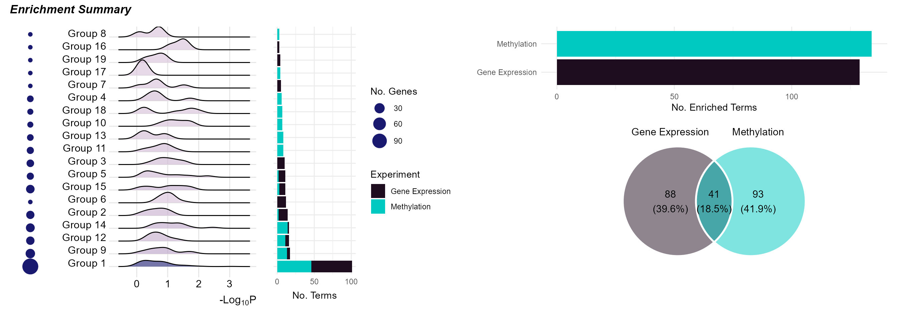
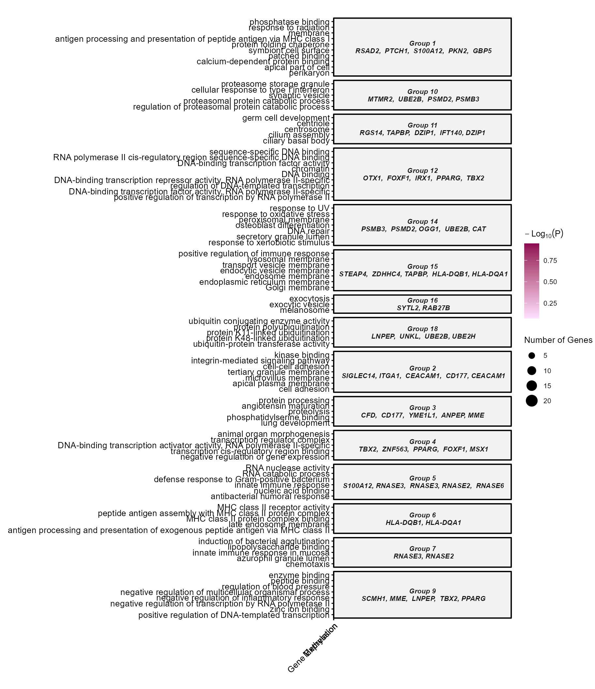
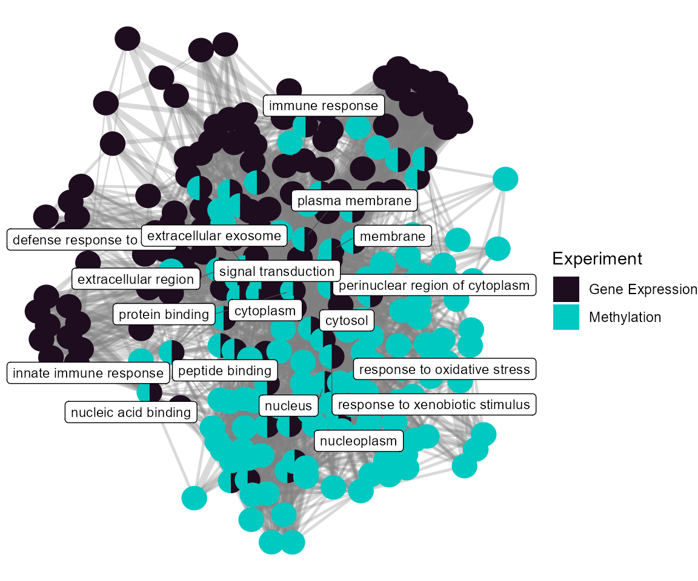
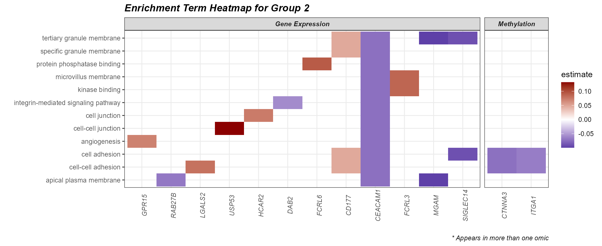
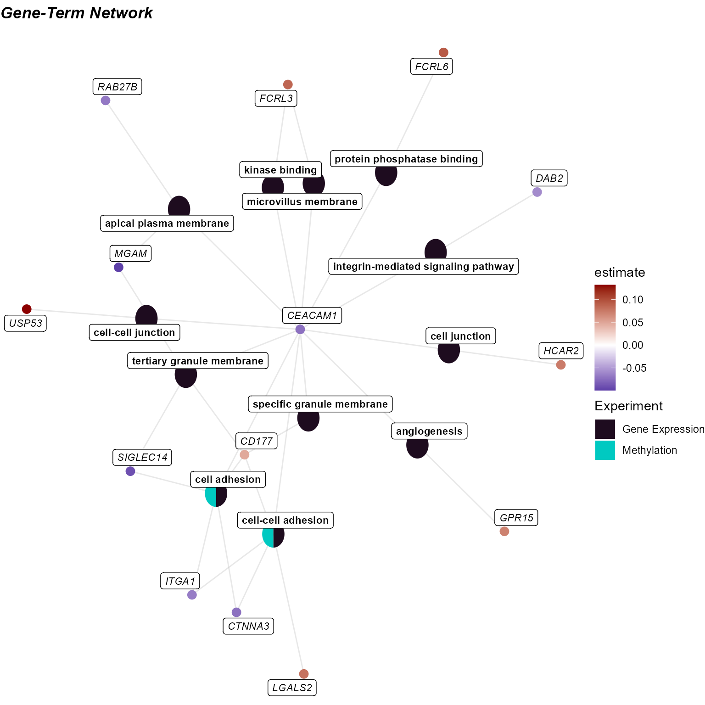

# Biological Interpretation

[Previous: Multi-omics
Integration](https://BioNomad.github.io/tidyexposomics/articles/multi_omics_integration.md)

**Objectives**

- Understand how enrichment analysis connects omics features to
  biological processes.
- Extract exposure-associated omics features from association results
  with `extract_results`.
- Run Gene Ontology enrichment on exposure-associated features with
  `run_enrichment`.
- Summarize and plot enrichment results across exposure categories and
  omics layers.

### Prerequisites

We covered [omics/exposure
preprocessing](https://BioNomad.github.io/tidyexposomics/articles/omics_preprocessing.md)
and [exposure-omics association
testing](https://BioNomad.github.io/tidyexposomics/articles/exposure_omics_associations.md)
in a previous vignette. Here is the quick start code to catch you up to
speed!

Click to expand code

``` r
# Load Libraries
library(tidyverse)
library(tidyexposomics)

# Load example data
data("tidyexposomics_example")

# Create exposomic set object
expom <- create_exposomicset(
    codebook = tidyexposomics_example$annotated_cb,
    exposure = tidyexposomics_example$meta,
    omics = list(
        "Gene Expression" = tidyexposomics_example$exp_filt,
        "Methylation" = tidyexposomics_example$methyl_filt
    ),
    row_data = list(
        "Gene Expression" = tidyexposomics_example$exp_fdata,
        "Methylation" = tidyexposomics_example$methyl_fdata
    )
)

# Grab exposure variables
exp_vars <- tidyexposomics_example$annotated_cb |>
    filter(category %in% c(
        "aerosol",
        "main group molecular entity",
        "polyatomic entity"
    )) |>
    pull(variable) |>
    as.character()

# Impute missing values
expom <- run_impute_missing(
    exposomicset = expom,
    exposure_impute_method = "missforest",
    exposure_cols = exp_vars
)

# Check variable normality
expom <- run_normality_check(
    exposomicset = expom,
    action = "add"
)

# Transform variables
expom <- transform_exposure(
    exposomicset = expom,
    transform_method = "boxcox_best",
    exposure_cols = exp_vars
)

# Run association testing between every exposure and omics feature
expom <- run_exposure_omics_association(
    exposomicset = expom,
    exposures = exp_vars,
    action = "add"
)
```

### Biological Interpretation

This is perhaps the most difficult task in all this. Omics readouts are
almost always noisy and discovering that one consistent nugget of
biological truth is not trivial. Luckily, `tidyexposomics` provides many
ways of getting at biological signals. One such way is gene ontology
(GO) enrichment, which identifies processes where omics features are
over-represented.

## Enrichment Analysis

------------------------------------------------------------------------

Enrichment analysis tests whether a set of molecular features
(e.g. differentially abundant genes, metabolites, etc.) is
over-represented in a predefined biological process. The benefit of
grouping our exposures into categories is that we can now determine how
broad categories of exposures are tied to biological processes. The
`run_enrichment` function can perform enrichment analysis on the
following feature types:

- `degs`: Differentially abundant features.

- `degs_robust`: Robust differentially abundant features from the
  sensitivity analysis.

- `omics`: User chosen features.

- `factor_features`: Multi-omics factor features either from
  `factor_type = “common_top_factor_features”` or
  `“top_factor_features”`.

- `degs_cor`: Differentially abundant features correlated with a set of
  exposures.

- `omics_cor`: User chosen features correlated with a set of exposures.

- `factor_features_cor`: Multi-omics factor features correlated with a
  set of exposures.

Here we will run enrichment analysis on omics features associated with
exposures. Specifically, we will grab omics features associated with
aerosols using the `extract_results` function. This function allows us
to pull any of the results we have been generating so far. We will then
filter these association results to significant associations (p-value \<
0.05) and those with the `category` “aerosol”.

``` r
# Extract omics features associated with aerosols
var_map <- extract_results(
  exposomicset = expom,
  result = "association"
) |> 
  pluck("exposure_omics",
        "results_df") |> 
  filter(p.value<0.05) |>
  filter(category == "aerosol") |> 
  dplyr::select(
    exp_name = exp_name,
    variable = feature
    
  )
```

Now we will perform enrichment analysis and specify `feature_col` to
represent the column in our feature metadata with IDs that can be mapped
(i.e. gene names). We will be performing Gene ontology enrichment
powered by the [`fenr`
package](https://www.bioconductor.org/packages/release/bioc/html/fenr.html)
(Fenr, 2025). Note that we specify a `clustering_approach.` This will
cluster our enrichment terms by the molecular feature overlap.

``` r
# Run enrichment analysis on factor features correlated with exposures
expom <- run_enrichment(
    exposomicset = expom,
    variable_map = var_map,
    feature_type = "omics",
    feature_col = "feature_clean",
    db = c("GO"),
    species = "goa_human",
    fenr_col = "gene_symbol",
    padj_method = "none",
    pval_thresh = 1,
    min_set = 1,
    max_set = 800,
    clustering_approach = "diana",
    action = "add"
)
```

### Enrichment Visualizations

To visualize our enrichment results we provide several options:

- dot\`plot: A dot plot showing the top enriched terms. The size of the
  dots represents the number of features associated with the term, while
  the color represents the significance of the term.

- `cnet`: A network plot showing the relationship between features and
  enriched terms.

- `network`: A network plot showing the relationship between enriched
  terms.

- `heatmap`: A heatmap showing the relationship between features and
  enriched terms.

- `summary`: A summary figure of the enrichment results.

#### Enrichment Summary

To summarize the enrichment results, we can use the `plot_enrichment`
function with the `plot_type` argument set to `summary.` This will plot
a summary of the enrichment results, showing:

- The number of exposure categories per enrichment term group.

- The number of features driving the enrichment term group.

- A p-value distribution of the enrichment term group.

- The number of terms in the enrichment term group.

- The total number of terms per experiment name.

- The overlap in enrichment terms between experiments (i.e. between gene
  expression and methylation).

``` r
# Plot the summary diagram
plot_enrichment(
    exposomicset = expom,
    feature_type = "omics",
    plot_type = "summary"
)
```



Here we see that it is just the features associated with “polyatomic
entity” exposures that seem to be enriched. Additionally, there appears
to be no overlap in terms between methylation and gene expression
results.

#### DotPlot

By setting the `plot_type` to dotplot we can create a dotplot to show
which omics are associated with which terms. By specifying the
`top_n_genes` we can add the most frequent features in that particular
enrichment term group.

``` r
# Plot a dotplot of terms
plot_enrichment(
    exposomicset = expom,
    feature_type = "omics",
    plot_type = "dotplot",
    top_n = 15,
    add_top_genes = TRUE,
    top_n_genes = 5
)
```



#### Term Network Plot

We can set the `plot_type` to `network` to understand how our enrichment
terms are individually connected.

``` r
# Plot the term network plot
# Setting a seed so that the plot layout is consistent
set.seed(42)
plot_enrichment(
    exposomicset = expom,
    feature_type = "omics",
    plot_type = "network",
    label_top_n = 3
)
```



At the individual term level, we see that they differ by omics layer,
with the gene expression driving terms related to vesicle traficking and
the methylation data driving terms related to G protein-coupled receptor
signaling.

#### Heatmap

Setting the `plot_type` to `heatmap` can help us understand which genes
are driving the enrichment terms. First we need to create a `fill_df` so
we know how to fill the tiles. Here we use the median estimate

``` r
# Build the fill table
# one estimate per experiment x feature
fill_df <- extract_results(
    exposomicset = expom,
    result = "association"
) |>
    pluck("exposure_omics", "results_df") |>
    filter(
        p.value < 0.05,
        category == "aerosol"
    ) |>
    reframe(
        estimate = median(estimate),
        .by = c(exp_name, feature)
    )
```

Now we can use this fill information to make our heatmap! Let’s see what
features are driving Group 2:

``` r
# Plot a heatmap of genes and corresponding GO terms
plot_enrichment(
    exposomicset = expom,
    feature_type = "omics",
    go_groups = "Group 2",
    plot_type = "heatmap",
    fill_data = fill_df,
    feature_col = "feature_clean"
)
```



#### Cnet Plot

Another way to visualize this information is with the `cnet` plot, where
the enrichment terms are connected to the omics features driving them.

``` r
# Plot the gene-term network
# Setting a seed so that the plot layout is consistent
set.seed(42)
plot_enrichment(
    exposomicset = expom,
    feature_type = "omics",
    go_groups = "Group 2",
    plot_type = "cnet",
    fill_data = fill_df,
    feature_col = "feature_clean",
)
```



[Next: Single-cell-Exposure
Associations](https://BioNomad.github.io/tidyexposomics/articles/single_cell_exposure_associations.md)
