# Exposure-Omics-Phenotype Workflow

**Objectives**

- Create an `exposomicset` object from a codebook and exposure metadata.
- Learn how to add in omics data to the `exposomicset` object.
- Identify and visualize missing values in exposure data.
- Impute missing exposure values.
- Assess variable normality and apply transformations to improve it.
- Run an exposome-wide association study (ExWAS) to test many exposures
  against a single outcome.
- Fit interaction models to test whether an exposure-outcome
  relationship depends on another variable.
- Stratify models or subset samples to examine specific subgroups.
- Compare effect estimates across models.
- Filter omics data to remove features with low expression/abundance or
  variance.
- Test for differentially abundant omics features associated with an
  outcome using.
- Visualize differential abundance results across omics layers.
- Test associations between every exposure and every omics feature.
- Understand how enrichment analysis connects omics features to
  biological processes.
- Extract exposure-associated omics features from association results
  with `extract_results`.
- Run Gene Ontology enrichment on exposure-associated features with
  `run_enrichment`.
- Summarize and plot enrichment results across exposure categories and
  omics layers.

## Exposure Preprocessing

### Getting the data in order

To get started with an exposure-outcome-only workflow, we need to create
our exposomicset which stores this data. This time, we are going to add
in the omics data too!

``` r
# Load Libraries
library(tidyexposomics)

# Load example data
data("tidyexposomics_example")

# Create exposomic set object
expom <- create_exposomicset(
  codebook = tidyexposomics_example$annotated_cb,
  exposure = tidyexposomics_example$meta,
  omics = list(
    "Gene Expression" = tidyexposomics_example$exp_filt,
    "Methylation" = tidyexposomics_example$methyl_filt
  ),
  row_data = list(
    "Gene Expression" = tidyexposomics_example$exp_fdata,
    "Methylation" = tidyexposomics_example$methyl_fdata
  )
)
```

Here you will see we have two lists: (1) the omics matrices, where the
rows are omics features (e.g. genes, proteins, metabolites) and the
columns are samples, (2) row data with information about these omics
features. We also gave it a codebook with information about the
exposures ([see more about codebooks
here](https://BioNomad.github.io/tidyexposomics/articles/exposure_annotation.md)),
and the meta data which contain the exposures and covariate information.

For the sake of simplicity we will focus on a short list of exposures:

``` r
# Grab exposure variables
exp_vars <- tidyexposomics_example$annotated_cb |>
  dplyr::filter(
    category %in% c(
      "aerosol",
      "main group molecular entity",
      "polyatomic entity"
    )
  ) |>
  dplyr::pull(variable) |>
  as.character()
```

## Quality Control

------------------------------------------------------------------------

### Missingness

Oftentimes when collecting data, there are missing values. Let’s use the
`plot_missing` function to determine where our missing values are:

``` r
# Plot the missingness summary
plot_missing(
  exposomicset = expom,
  plot_type = "summary",
  threshold = 0
)
```

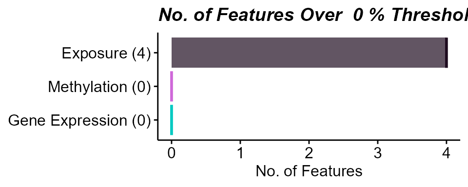

Here we see that there are 4 variables in the exposure data that are
missing data. Let’s take a look at them:

``` r
# Plot missing variables withing exposure group
plot_missing(
  exposomicset = expom,
  plot_type = "lollipop",
  threshold = 0,
  layers = "Exposure"
)
```

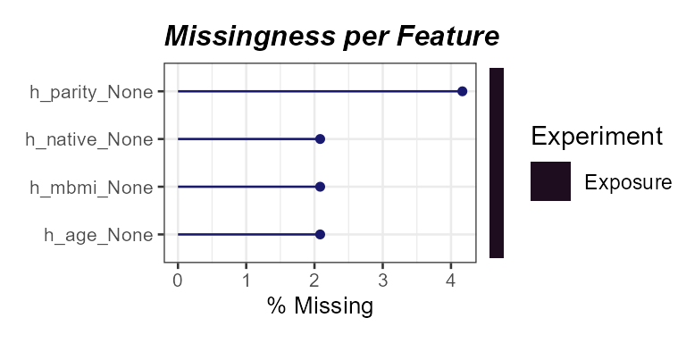

Here we see that one variable, `h_parity_None`, has about 4% missing
values. We can apply a missingness filter using the `filter_missing`
function. However, given that this level of missingness is quite low, we
will not be applying a missingness filter and instead impute the missing
data.

### Imputation

The `run_impute_missing` function is used to impute missing values. Here
we can specify the imputation method for exposure and omics data
separately.

The `exposure_impute_method` argument is used to set the imputation
method for exposure data, and the `omics_impute_method` argument is used
to set the imputation method for omics data. The `omics_to_impute`
argument is used to specify which omics data to impute. Here we will
impute the exposure data given using the `missforest` method, but other
options for imputation methods include:

- `median`: Imputes missing values with the median of the variable.

- `mean`: Imputes missing values with the mean of the variable.

- `knn`: Uses k-nearest neighbors to impute missing values.

- `mice`: Uses the Multivariate Imputation by Chained Equations (MICE)
  method to impute missing values.

- `missforest`: Uses the MissForest method to impute missing values.

- `lod_sqrt2`: Imputes missing values using the square root of the lower
  limit of detection (LOD) for each variable. This is useful for
  variables that have a lower limit of detection, such as chemical
  exposures.

``` r
# Impute missing values
expom <- run_impute_missing(
  exposomicset = expom,
  exposure_impute_method = "missforest",
  exposure_cols = exp_vars
)
```

### Normality Check

When determining variable associations, it is important to check the
normality of the data. The `run_normality_check` function is used to
check the normality of the data.

``` r
# Check variable normality
expom <- run_normality_check(
  exposomicset = expom,
  action = "add"
)
```

The `transform_exposure` function is used to transform the data to make
it more normal. Here the transform_method is set to `boxcox_best` as it
will automatically select the best transformation method based on the
data. The `transform_method` can be manually set to `log2`, `sqrt`, or
`x_1_3` as well. We specify the exposure_cols argument to set the
columns to transform.

``` r
# Transform variables
expom <- transform_exposure(
  exposomicset = expom,
  transform_method = "boxcox_best",
  exposure_cols = exp_vars
)
```

To check the normality of the exposure data, we can use the
`plot_normality_summary` function. This function plots the normality of
the data before and after transformation. The `transformed` argument is
set to `TRUE` to plot the normality status of the transformed data.

``` r
# Examine normality summary
plot_normality_summary(
  exposomicset = expom,
  transformed = TRUE
)
```

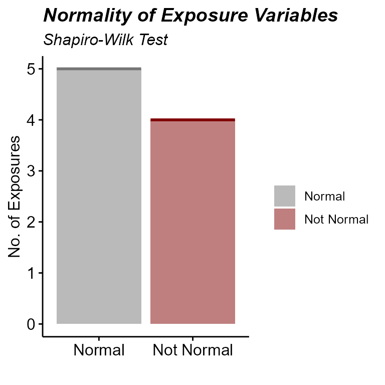

### Exposure Summary

We can summarize the exposure data using the `run_summarize_exposures`
function. This function calculates summary statistics for each exposure
variable, including the number of values, number of missing values,
minimum, maximum, range, sum, median, mean, standard error, and
confidence intervals. The `exposure_cols` argument determines which
variables to include in the summary.

``` r
# Summarize exposure data
run_summarize_exposures(
  exposomicset = expom,
  action = "get",
  exposure_cols = exp_vars
) |>
  head()
```

    ## # A tibble: 6 × 27
    ##   variable   n_values  n_na   min   max range    sum median  mean    se ci_lower
    ##   <chr>         <dbl> <dbl> <dbl> <dbl> <dbl>  <dbl>  <dbl> <dbl> <dbl>    <dbl>
    ## 1 h_pm10_ra…       48     0 16.6  25.8   9.25 1.01e3  21.3  21.0   0.31    20.4 
    ## 2 h_pm25_ra…       48     0 10.6  18.2   7.55 7.12e2  14.7  14.8   0.24    14.3 
    ## 3 hs_bpa_ma…       48     0  0     2.31  2.31 7.30e1   1.58  1.52  0.05     1.41
    ## 4 hs_mibp_c…       48     0  0.1   0.22  0.11 7.83e0   0.17  0.16  0        0.16
    ## 5 hs_pb_c_L…       48     0  1.44  5     3.56 1.59e2   3.32  3.32  0.1      3.11
    ## 6 hs_pfhxs_…       48     0  0     2.14  2.13 6.72e1   1.49  1.4   0.07     1.25
    ## # ℹ 16 more variables: ci_upper <dbl>, variance <dbl>, sd <dbl>,
    ## #   coef_var <dbl>, period <chr>, location <chr>, description <chr>,
    ## #   var_type <chr>, transformation <chr>, selected_ontology_label <chr>,
    ## #   selected_ontology_id <chr>, root_id <chr>, root_label <chr>,
    ## #   category <chr>, category_source <chr>, transformation_applied <chr>

### Exposure Visualization

------------------------------------------------------------------------

To visualize our exposure data, we can use the `plot_exposures`
function. This function allows us to plot the exposure data in a variety
of ways. Here we will plot the exposure data using a boxplot. The
`exposure_cat` argument is used to set the exposure category to plot.
Additionally, we could specify `exposure_cols` to only plot certain
exposures. The `plot_type` argument is used to set the type of plot to
create. Here we use a boxplot, but we could also use a ridge plot.

``` r
# Plot aerosol exposure distributions by sex
plot_exposures(
  exposomicset = expom,
  group_by = "e3_sex_None",
  exposure_cols = c(
    "h_pm25_ratio_preg_None",
    "h_pm10_ratio_preg_None"
  ),
  plot_type = "boxplot",
  ylab = "Values",
  title = "Aerosol Exposure by Sex"
) +
  ggpubr::stat_compare_means(label = "p.signif")
```

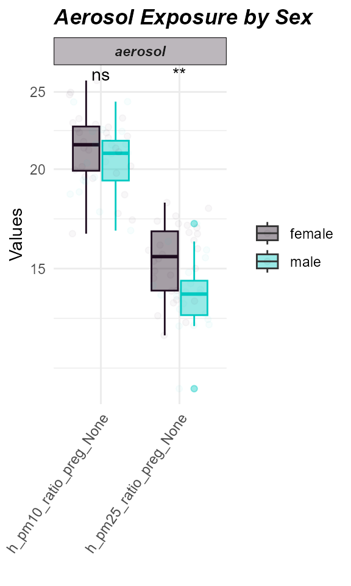

Here we see that levels of PM2.5 were higher in females compared to
males.

### Coverting the Exposomicset back to dataframes

If you need to grab your codebook, feel free to do so using the
`extract_results` function:

``` r
extract_results(
  exposomicset = expom,
  result = "codebook"
) |>
  head()
```

    ## # A tibble: 6 × 13
    ##   variable               period    location description  var_type transformation
    ##   <chr>                  <chr>     <chr>    <chr>        <chr>    <chr>         
    ## 1 h_pm10_ratio_preg_None Pregnancy Home     pm10 value … numeric  None          
    ## 2 h_pm25_ratio_preg_None Pregnancy Home     pm25 value … numeric  None          
    ## 3 hs_pm10_yr_hs_h_None   Postnatal Home     pm10 value … numeric  None          
    ## 4 hs_pm25_yr_hs_h_None   Postnatal Home     pm25 value … numeric  None          
    ## 5 h_mbmi_None            Pregnancy NA       Maternal pr… numeric  None          
    ## 6 e3_gac_None            Pregnancy NA       Gestational… numeric  None          
    ## # ℹ 7 more variables: selected_ontology_label <chr>,
    ## #   selected_ontology_id <chr>, root_id <chr>, root_label <chr>,
    ## #   category <chr>, category_source <chr>, transformation_applied <chr>

If you want to grab the exposure+metadata do so using the `pivot_sample`
function:

``` r
expom |>
  pivot_sample() |>
  head()
```

    ## # A tibble: 6 × 19
    ##   .sample e3_sex_None hs_child_age_None h_age_None h_mbmi_None e3_gac_None
    ##   <chr>   <fct>                   <dbl>      <dbl>       <dbl>       <dbl>
    ## 1 s812    female                   6.84       35          33.2        41.4
    ## 2 s296    female                   6.75       32.8        25.1        39.1
    ## 3 s242    female                   6.97       33          24.6        40.4
    ## 4 s376    male                     6.35       27.1        28.3        37  
    ## 5 s1183   female                   6.74       32.7        33.3        38.1
    ## 6 s98     female                   6.93       23          31.2        39  
    ## # ℹ 13 more variables: h_native_None <fct>, h_parity_None <fct>,
    ## #   hs_asthma <dbl>, hs_zbmi_who <dbl>, h_pm10_ratio_preg_None <dbl>,
    ## #   h_pm25_ratio_preg_None <dbl>, hs_pm10_yr_hs_h_None <dbl>,
    ## #   hs_pm25_yr_hs_h_None <dbl>, hs_pb_c_Log2 <dbl>, hs_pfhxs_m_Log2 <dbl>,
    ## #   hs_pfna_c_Log2 <dbl>, hs_bpa_madj_Log2 <dbl>, hs_mibp_cadj_Log2 <dbl>

## ExWAS

### Exposome-wide association study (ExWAS)

Inspired by the concept of genome-wide association studies, or GWAS, the
ExWAS is a high-throughput way of identifying many exposures with an
association to an outcome. The `run_association` allows us to see which
exposure variables are associated with our outcome, `hs_asthma`, which
is a 0 or 1, so we set the family to `binomial`. If the variable was
continuous, we’d usually set it to `gaussian`. Just one more note: since
we are running this model on many different exposures, we use `.feature`
as a placeholder:

``` r
# Perform ExWAS
expom <- run_association(
  exposomicset = expom,
  formula = hs_asthma ~ .feature,
  source = "exposures",
  feature_set = exp_vars,
  action = "add",
  family = "binomial"
)
```

We can visualize these associations using the `plot_association`
function and set our p-value filter to color associations below that
threshold, here we set it to 0.3 just to demonstrate the coloring, but
we suggest using the `p_adjust` column for `filter_col` and a cutoff of
0.05:

``` r
# Plot the association forest plot
plot_association(
  exposomicset = expom,
  effect = "main",
  source = "exposures",
  terms = exp_vars,
  filter_thresh = 0.3,
  up_col = "#8E0152",
  down_col = "#006666",
  filter_col = "p.value",
  r2_col = "r2"
)
```

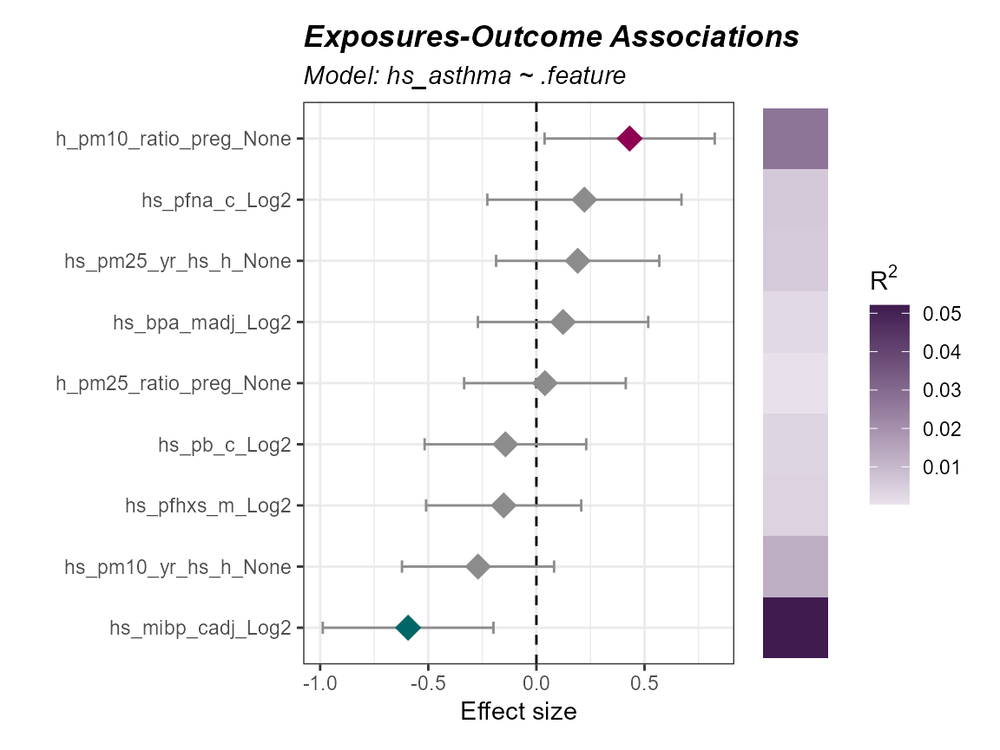

### Interaction Modeling

Sometimes, the relationship between an exposure an outcome *depends* on
another variable. For this folks tend to leverage interaction modeling.
Let’s look at how we would see if the the relationship between asthma
and an exposure depends on age:

``` r
run_association(
  exposomicset = expom,
  overwrite = TRUE,
  formula = hs_asthma ~ .feature * h_age_None,
  source = "exposures",
  feature_set = exp_vars,
  action = "add",
  family = "binomial"
) |>
  plot_association(
    effect = "h_age_None",
    source = "exposures",
    terms = exp_vars,
    filter_thresh = 0.3,
    up_col = "#8E0152",
    down_col = "#006666",
    filter_col = "p.value",
    r2_col = "r2"
  )
```

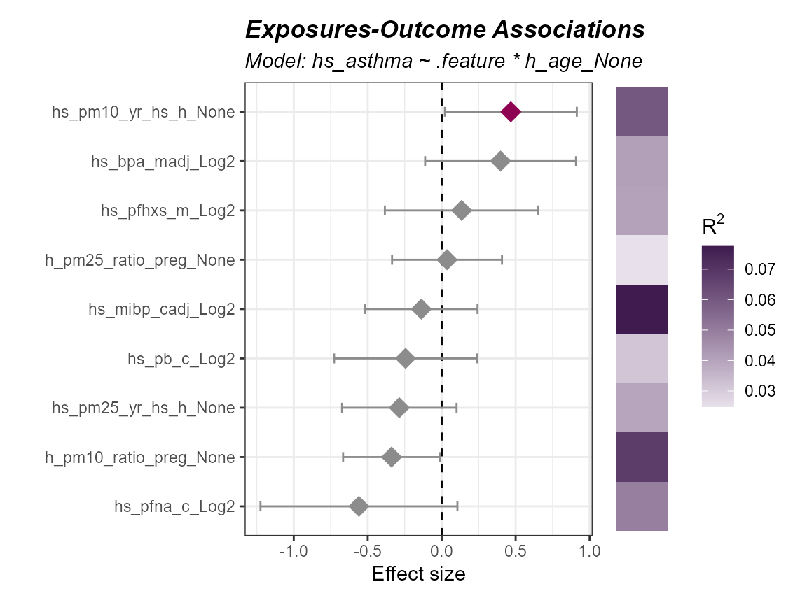

Notice, how we switched `effect = "main"` to `effect = "h_age_None"` so
that we could grab the interaction results.

### Stratifying Models

We may also want to run a model on a portion of our data, like say just
male patients:

``` r
expom |>
  run_association(
    formula = hs_asthma ~ .feature + h_age_None,
    source = "exposures",
    overwrite = TRUE,
    feature_set = exp_vars,
    family = "binomial",
    strata = "e3_sex_None",
    name = "by_sex"
  ) |>
  plot_association(
    effect = "main",
    source = "exposures",
    model = "by_sex_male",
    terms = exp_vars,
    filter_thresh = 0.3,
    up_col = "#8E0152",
    down_col = "#006666",
    filter_col = "p.value",
    r2_col = "r2"
  )
```

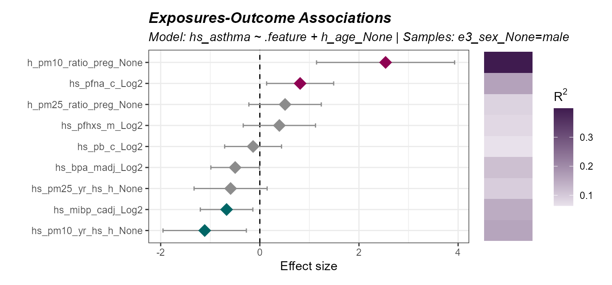

We can also filter our object with the `subset` argument. Let’s examine
the association in children with a higher BMI z-score:

``` r
expom |>
  run_association(
    formula = hs_asthma ~ .feature + h_age_None,
    source = "exposures",
    overwrite = TRUE,
    feature_set = exp_vars,
    family = "binomial",
    subset = hs_zbmi_who > 0,
    name = "high_bmi"
  ) |>
  plot_association(
    effect = "main",
    source = "exposures",
    model = "high_bmi",
    terms = exp_vars,
    filter_thresh = 0.3,
    up_col = "#8E0152",
    down_col = "#006666",
    filter_col = "p.value",
    r2_col = "r2"
  )
```

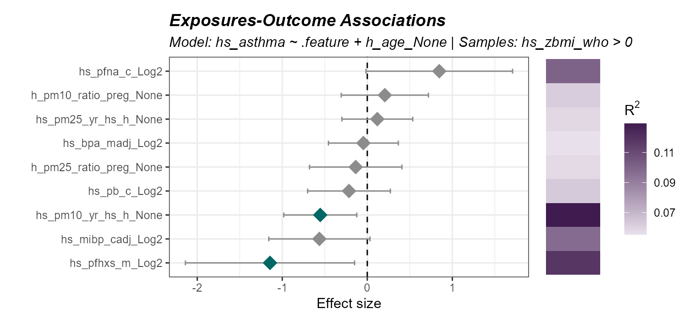

### Comparing models

Now sometimes we want to compare the results of different models. Here
we demonstrate how to make many different models using two approaches:
(1) specifying a list of formulas, and (2) using the `strata` or
`subset` functionality. This will create results for four different
models:

``` r
expom <- expom |>
  run_association(
    formula = list(
      crude = hs_asthma ~ .feature,
      adj = hs_asthma ~ .feature + h_age_None
    ),
    source = "exposures",
    overwrite = TRUE,
    feature_set = exp_vars,
    family = "binomial"
  ) |>
  run_association(
    formula = hs_asthma ~ .feature + h_age_None,
    source = "exposures",
    feature_set = exp_vars,
    family = "binomial",
    strata = "e3_sex_None",
    name = "by_sex"
  )
```

To see what model results are available you can use the following:

``` r
association_models(expom)
```

    ## # A tibble: 5 × 8
    ##   source    model         formula     subset stratum family n_samples n_features
    ##   <chr>     <chr>         <chr>       <chr>  <chr>   <chr>      <int>      <int>
    ## 1 exposures default       hs_asthma … NA     NA      binom…        48          9
    ## 2 exposures crude         hs_asthma … NA     NA      binom…        48          9
    ## 3 exposures adj           hs_asthma … NA     NA      binom…        48          9
    ## 4 exposures by_sex_female hs_asthma … NA     female  binom…        28          9
    ## 5 exposures by_sex_male   hs_asthma … NA     male    binom…        20          9

Now let’s demonstrate how to compare two models, here we will compare
effect estimates for males and females:

``` r
expom |>
  compare_association(
    "exposures",
    models = c(
      "by_sex_female",
      "by_sex_male"
    )
  ) |>
  plot_association_comparison(type = "forest")
```

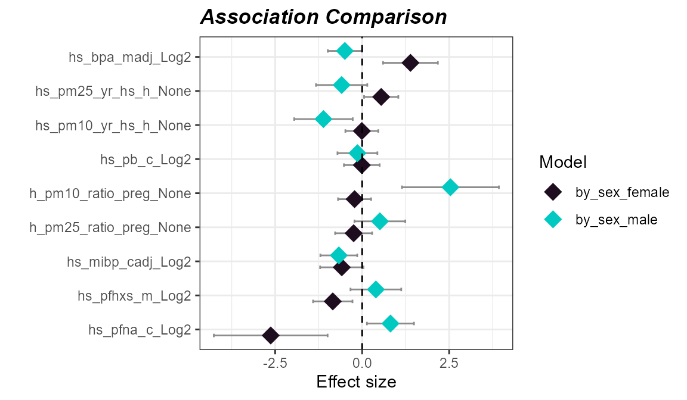

We could also choose to visualize it using a scatter plot:

``` r
expom |>
  compare_association(
    "exposures",
    models = c(
      "by_sex_female",
      "by_sex_male"
    )
  ) |>
  plot_association_comparison(type = "scatter")
```

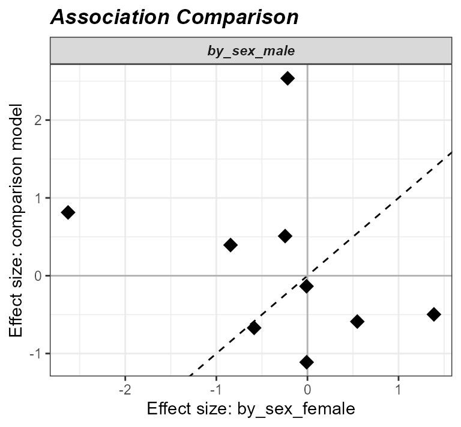

Here we see that the effect estimates are not correlated with one
another, suggesting that the relationship between asthma and exposure
differs by sex.

## Omics Preprocessing

### Filtering Omics Features

We can filter omics features based on variance or expression levels. The
`filter_omics` function is used to filter omics features. The method
argument is used to set the method for filtering. Here we can use
either:

- **Variance**: Filters features based on variance. We recommend this
  for omics based on continuous measurements, such as log-transformed
  counts, M-values, protein intensities, or metabolite concentrations.

- **Expression**: Filters features based on expression levels. We
  recommend this for omics where many values may be near-zero or zero,
  such as RNA-seq data.

The `assays` argument is used to specify which omics data to filter. The
`assay_name` argument is used to specify which assay to filter. The
`min_var`, `min_value`, and `min_prop` arguments are used to set the
minimum variance, minimum expression value, and minimum proportion of
samples exceeding the minimum value, respectively.

``` r
# filter omics layers by variance and expression
# Methylation filtering
expom <- filter_omics(
  exposomicset = expom,
  method = "variance",
  assays = "Methylation",
  assay_name = 1,
  min_var = 0.05
)

# Gene expression filtering
expom <- filter_omics(
  exposomicset = expom,
  method = "expression",
  assays = "Gene Expression",
  assay_name = 1,
  min_value = 1,
  min_prop = 0.3
)
```

## Differential Abundance

We provide functionality to test for differentially abundant features
associated with an outcome across multiple omics layers. This is done
using the `run_differential_abundance` function, which fits a model
defined by the user (using the `formula` argument) and supports several
methods. Here we apply the `limma_trend` method, a widely used approach
for analyzing omics data. Users can also specify how features are scaled
(e.g. none, quantile, TMM) before fitting.

``` r
# Run differential abundance analysis
expom <- run_differential_abundance(
  exposomicset = expom,
  formula = ~hs_asthma,
  method = "limma_trend",
  scaling_method = "none",
  action = "add"
)
```

We can summarize the results of the differential abundance analysis with
a volcano plot, which highlights features with a high log fold change
and that are statistically significant. The `plot_volcano` function
generates this visualization, with options to set thresholds for
p-values and log fold changes, and to label a subset of top-ranked
features. In this example, we use the `feature_clean` column to display
interpretable feature names.

**Note:** we set the `pval_col` to `P.Value` for the purposes of this
example, but we recommend keeping the default of `adj.P.Val` to use the
adjusted p-values.

``` r
# Plot the volcano plot
plot_volcano(
  exposomicset = expom,
  top_n_label = 3,
  feature_col = "feature_clean",
  logFC_thresh = log2(1),
  pval_thresh = 0.05,
  pval_col = "P.Value",
  logFC_col = "logFC",
  nrow = 1
)
```

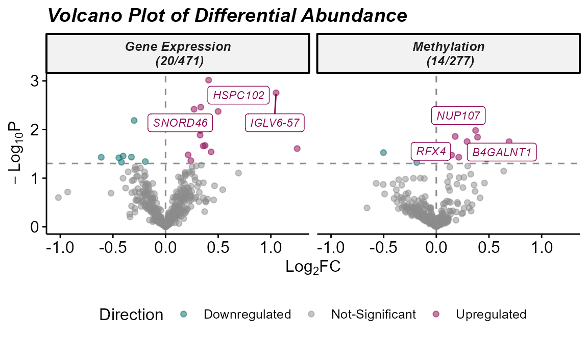

## Exposure-Omics Association

------------------------------------------------------------------------

### Exposure-Omics Association

Above we saw that there are not too many omics features associated with
asthma. Which may be due to the subsampling in this example or because
exposures are driving different biology. Let’s examine what omics
features exposures are associated with.

``` r
# Run association testing between every exposure and omics feature
expom <- run_exposure_omics_association(
  exposomicset = expom,
  exposures = exp_vars,
  action = "add"
)
```

Now let’s see how many omics features each exposure is associated with
using the `plot_exposure_omics_association` function where we can either
plot by the individual exposure or exposure category:

``` r
# Plot the number of exposure-omics associations
plot_exposure_omics_association(
  exposomicset = expom,
  plot_type = "category",
  pval_col = "p.value",
  pval_thresh = 0.05
)
```

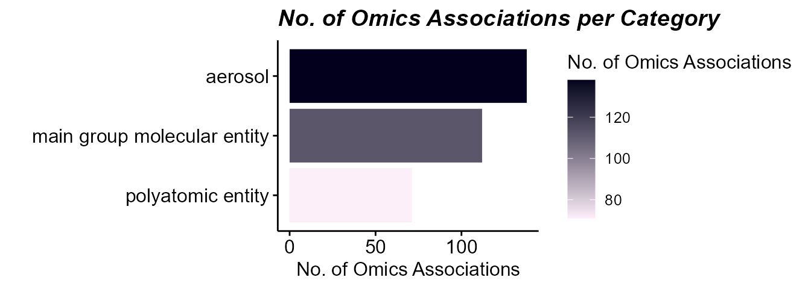

Here we can see that there are omics features associated with exposures,
while there are fewer that are associated with asthma directly.

## Biological Interpretation

This is perhaps the most difficult task in all this. Omics readouts are
almost always noisy and discovering that one consistent nugget of
biological truth is not trivial. Luckily, `tidyexposomics` provides many
ways of getting at biological signals. One such way is gene ontology
(GO) enrichment, which identifies processes where omics features are
over-represented.

### Enrichment Analysis

------------------------------------------------------------------------

Enrichment analysis tests whether a set of molecular features
(e.g. differentially abundant genes, metabolites, etc.) is
over-represented in a predefined biological process. The benefit of
grouping our exposures into categories is that we can now determine how
broad categories of exposures are tied to biological processes. The
`run_enrichment` function can perform enrichment analysis on the
following feature types:

- `degs`: Differentially abundant features.

- `degs_robust`: Robust differentially abundant features from the
  sensitivity analysis.

- `omics`: User chosen features.

- `factor_features`: Multi-omics factor features either from
  `factor_type = “common_top_factor_features”` or
  `“top_factor_features”`.

- `degs_cor`: Differentially abundant features correlated with a set of
  exposures.

- `omics_cor`: User chosen features correlated with a set of exposures.

- `factor_features_cor`: Multi-omics factor features correlated with a
  set of exposures.

Here we will run enrichment analysis on omics features associated with
exposures. Specifically, we will grab omics features associated with
aerosols using the `extract_results` function. This function allows us
to pull any of the results we have been generating so far. We will then
filter these association results to significant associations (p-value \<
0.05) and those with the `category` “aerosol”.

``` r
# Extract omics features associated with aerosols
var_map <- extract_results(
  exposomicset = expom,
  result = "association"
) |>
  purrr::pluck(
    "exposure_omics",
    "results_df"
  ) |>
  dplyr::filter(
    p.value < 0.05,
    category == "aerosol"
  ) |>
  dplyr::select(
    exp_name,
    variable = feature
  )
```

Now we will perform enrichment analysis and specify `feature_col` to
represent the column in our feature metadata with IDs that can be mapped
(i.e. gene names). We will be performing Gene ontology enrichment
powered by the [`fenr`
package](https://www.bioconductor.org/packages/release/bioc/html/fenr.html)
(Fenr, 2025). Note that we specify a `clustering_approach.` This will
cluster our enrichment terms by the molecular feature overlap.

``` r
# Run enrichment analysis on factor features correlated with exposures
expom <- run_enrichment(
  exposomicset = expom,
  variable_map = var_map,
  feature_type = "omics",
  feature_col = "feature_clean",
  db = c("GO"),
  species = "goa_human",
  fenr_col = "gene_symbol",
  padj_method = "none",
  pval_thresh = 1,
  min_set = 1,
  max_set = 800,
  clustering_approach = "diana",
  action = "add"
)
```

### Enrichment Visualizations

To visualize our enrichment results we provide several options:

- `dotplot`: A dot plot showing the top enriched terms. The size of the
  dots represents the number of features associated with the term, while
  the color represents the significance of the term.

- `cnet`: A network plot showing the relationship between features and
  enriched terms.

- `network`: A network plot showing the relationship between enriched
  terms.

- `heatmap`: A heatmap showing the relationship between features and
  enriched terms.

- `summary`: A summary figure of the enrichment results.

#### Enrichment Summary

To summarize the enrichment results, we can use the `plot_enrichment`
function with the `plot_type` argument set to `summary.` This will plot
a summary of the enrichment results, showing:

- The number of exposure categories per enrichment term group.

- The number of features driving the enrichment term group.

- A p-value distribution of the enrichment term group.

- The number of terms in the enrichment term group.

- The total number of terms per experiment name.

- The overlap in enrichment terms between experiments (i.e. between gene
  expression and methylation).

``` r
# Plot the summary diagram
plot_enrichment(
  exposomicset = expom,
  feature_type = "omics",
  plot_type = "summary"
)
```

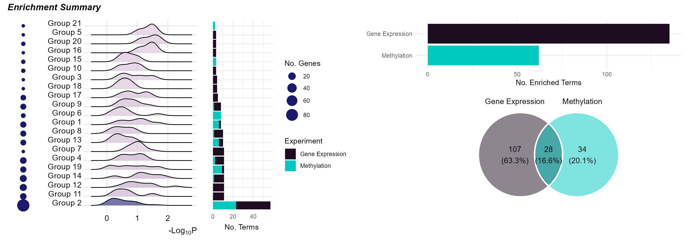

Here we see that it is just the features associated with “polyatomic
entity” exposures that seem to be enriched. Additionally, there appears
to be no overlap in terms between methylation and gene expression
results.

#### DotPlot

By setting the `plot_type` to dotplot we can create a dotplot to show
which omics are associated with which terms. By specifying the
`top_n_genes` we can add the most frequent features in that particular
enrichment term group.

``` r
# Plot a dotplot of terms
plot_enrichment(
  exposomicset = expom,
  feature_type = "omics",
  plot_type = "dotplot",
  top_n = 15,
  add_top_genes = TRUE,
  top_n_genes = 5
)
```

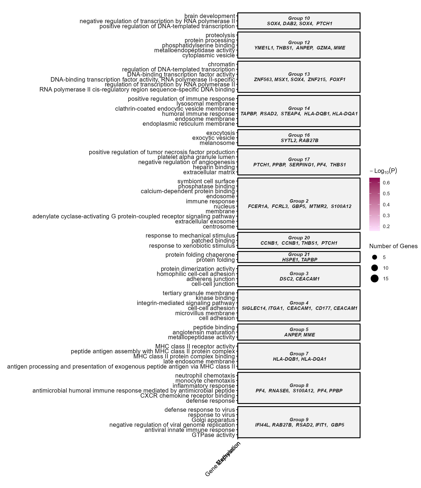

#### Term Network Plot

We can set the `plot_type` to `network` to understand how our enrichment
terms are individually connected.

``` r
# Plot the term network plot
# Setting a seed so that the plot layout is consistent
set.seed(42)

plot_enrichment(
  exposomicset = expom,
  feature_type = "omics",
  plot_type = "network",
  label_top_n = 3
)
```

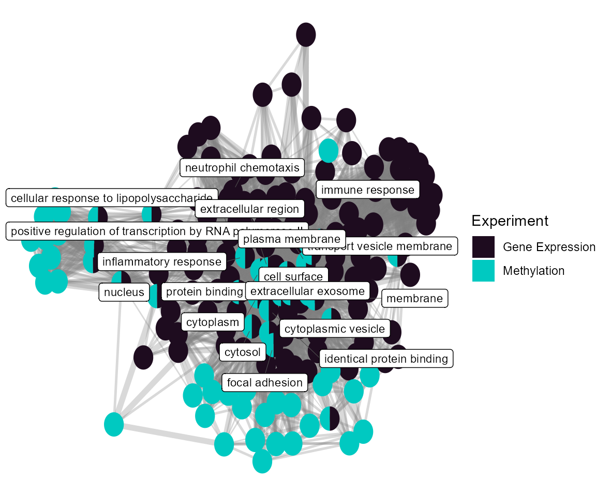

At the individual term level, we see that they differ by omics layer,
with the gene expression driving terms related to vesicle traficking and
the methylation data driving terms related to G protein-coupled receptor
signaling.

#### Heatmap

Setting the `plot_type` to `heatmap` can help us understand which genes
are driving the enrichment terms. First we need to create a `fill_df` so
we know how to fill the tiles. Here we use the median estimate

``` r
# Build the fill table
# one estimate per experiment x feature
fill_df <- extract_results(
  exposomicset = expom,
  result = "association"
) |>
  purrr::pluck(
    "exposure_omics",
    "results_df"
  ) |>
  dplyr::filter(
    p.value < 0.05,
    category == "aerosol"
  ) |>
  dplyr::reframe(
    estimate = median(estimate),
    .by = c(exp_name, feature)
  )
```

Now we can use this fill information to make our heatmap! Let’s see what
features are driving Group 2:

``` r
# Plot a heatmap of genes and corresponding GO terms
plot_enrichment(
  exposomicset = expom,
  feature_type = "omics",
  go_groups = "Group 2",
  plot_type = "heatmap",
  fill_data = fill_df,
  feature_col = "feature_clean"
)
```

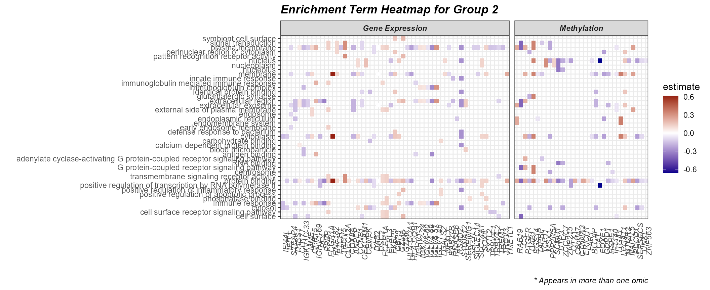

#### Cnet Plot

Another way to visualize this information is with the `cnet` plot, where
the enrichment terms are connected to the omics features driving them.

``` r
# Plot the gene-term network
# Setting a seed so that the plot layout is consistent
set.seed(42)

plot_enrichment(
  exposomicset = expom,
  feature_type = "omics",
  go_groups = "Group 2",
  plot_type = "cnet",
  fill_data = fill_df,
  feature_col = "feature_clean"
)
```

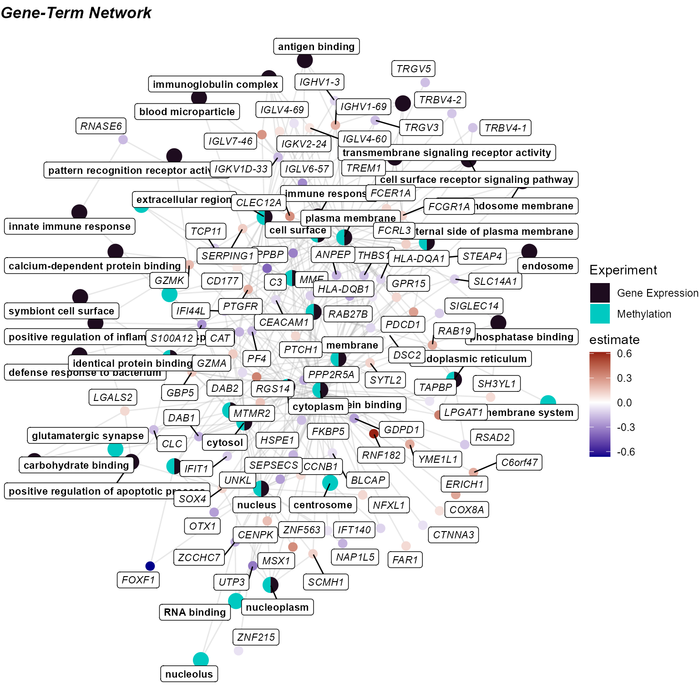

Session Info

``` r
sessionInfo()
```

    ## R version 4.5.1 (2025-06-13 ucrt)
    ## Platform: x86_64-w64-mingw32/x64
    ## Running under: Windows 11 x64 (build 26200)
    ## 
    ## Matrix products: default
    ##   LAPACK version 3.12.1
    ## 
    ## locale:
    ## [1] LC_COLLATE=English_United States.utf8 
    ## [2] LC_CTYPE=English_United States.utf8   
    ## [3] LC_MONETARY=English_United States.utf8
    ## [4] LC_NUMERIC=C                          
    ## [5] LC_TIME=English_United States.utf8    
    ## 
    ## time zone: America/New_York
    ## tzcode source: internal
    ## 
    ## attached base packages:
    ## [1] stats4    stats     graphics  grDevices utils     datasets  methods  
    ## [8] base     
    ## 
    ## other attached packages:
    ##  [1] tidyexposomics_1.1.3        MultiAssayExperiment_1.36.2
    ##  [3] SummarizedExperiment_1.40.0 Biobase_2.70.0             
    ##  [5] GenomicRanges_1.62.1        Seqinfo_1.0.0              
    ##  [7] IRanges_2.44.0              S4Vectors_0.48.0           
    ##  [9] BiocGenerics_0.56.0         generics_0.1.4             
    ## [11] MatrixGenerics_1.22.0       matrixStats_1.5.0          
    ## [13] BiocStyle_2.38.0           
    ## 
    ## loaded via a namespace (and not attached):
    ##   [1] naniar_1.1.0         RColorBrewer_1.1-3   rstudioapi_0.19.0   
    ##   [4] jsonlite_2.0.0       magrittr_2.0.4       farver_2.1.2        
    ##   [7] rmarkdown_2.31       fs_2.1.0             ragg_1.5.2          
    ##  [10] vctrs_0.7.3          memoise_2.0.1        base64enc_0.1-6     
    ##  [13] rstatix_1.1.0        itertools_0.1-3      htmltools_0.5.9     
    ##  [16] S4Arrays_1.10.1      forcats_1.0.1        BiocBaseUtils_1.12.0
    ##  [19] missForest_1.6.1     curl_7.0.0           broom_1.0.13        
    ##  [22] SparseArray_1.10.8   Formula_1.2-6        sass_0.4.10         
    ##  [25] bslib_0.12.0         htmlwidgets_1.6.4    desc_1.4.3          
    ##  [28] httr2_1.3.0          cachem_1.1.0         igraph_2.3.3        
    ##  [31] iterators_1.0.14     mime_0.13            lifecycle_1.0.5     
    ##  [34] pkgconfig_2.0.3      Matrix_1.7-4         R6_2.6.1            
    ##  [37] fastmap_1.2.0        rbibutils_2.4.1      shiny_1.14.0        
    ##  [40] digest_0.6.39        ggnewscale_0.5.2     colorspace_2.1-3    
    ##  [43] patchwork_1.3.2      textshaping_1.0.5    Hmisc_5.2-6         
    ##  [46] RSQLite_3.53.3       ggpubr_1.0.0         filelock_1.0.3      
    ##  [49] labeling_0.4.3       randomForest_4.7-1.2 polyclip_1.10-7     
    ##  [52] httr_1.4.8           abind_1.4-8          compiler_4.5.1      
    ##  [55] rngtools_1.5.2       bit64_4.8.2          withr_3.0.3         
    ##  [58] htmlTable_2.5.0      S7_0.2.1             backports_1.5.1     
    ##  [61] viridis_0.6.5        carData_3.0-6        DBI_1.3.0           
    ##  [64] ggforce_0.5.0        ggsignif_0.6.4       MASS_7.3-65         
    ##  [67] DelayedArray_0.36.0  ggsci_5.2.0          tools_4.5.1         
    ##  [70] foreign_0.8-90       ranger_0.18.0        otel_0.2.0          
    ##  [73] httpuv_1.6.17        visdat_0.6.0         nnet_7.3-20         
    ##  [76] glue_1.8.0           promises_1.5.0       grid_4.5.1          
    ##  [79] checkmate_2.3.4      ggvenn_0.1.19        cluster_2.1.8.3     
    ##  [82] gtable_0.3.6         tzdb_0.5.0           tidyr_1.3.2         
    ##  [85] data.table_1.18.2.1  hms_1.1.4            tidygraph_1.3.1     
    ##  [88] utf8_1.2.6           car_3.1-5            XVector_0.50.0      
    ##  [91] ggrepel_0.9.8        foreach_1.5.2        pillar_1.11.1       
    ##  [94] stringr_1.6.0        vroom_1.7.1          limma_3.66.0        
    ##  [97] later_1.4.8          splines_4.5.1        tweenr_2.0.3        
    ## [100] dplyr_1.2.1          BiocFileCache_3.0.0  lattice_0.22-7      
    ## [103] bit_4.6.0            tidyselect_1.2.1     locfit_1.5-9.12     
    ## [106] knitr_1.51           gridExtra_2.3.1      bookdown_0.47       
    ## [109] edgeR_4.8.2          xfun_0.60            graphlayouts_1.2.5  
    ## [112] statmod_1.5.2        factoextra_2.2.0     DT_0.34.0           
    ## [115] stringi_1.8.7        yaml_2.3.12          codetools_0.2-20    
    ## [118] evaluate_1.0.5       ggraph_2.2.2         fenr_1.8.2          
    ## [121] tidybulk_2.0.1       tibble_3.3.0         BiocManager_1.30.27 
    ## [124] cli_3.6.5            rpart_4.1.24         Rdpack_2.6.6        
    ## [127] xtable_1.8-8         systemfonts_1.3.2    jquerylib_0.1.4     
    ## [130] Rcpp_1.1.1           dbplyr_2.6.0         parallel_4.5.1      
    ## [133] ggh4x_0.3.1          pkgdown_2.2.1        ggplot2_4.0.3       
    ## [136] readr_2.2.0          assertthat_0.2.1     blob_1.3.0          
    ## [139] doRNG_1.8.6.3        viridisLite_0.4.3    ggridges_0.5.7      
    ## [142] scales_1.4.0         purrr_1.2.2          crayon_1.5.3        
    ## [145] rlang_1.3.0
