# Exposure-Phenotype Workflow

**Objectives**

- Create an `exposomicset` object from a codebook and exposure metadata.
- Identify and visualize missing values in exposure data.
- Impute missing exposure values.
- Assess variable normality and apply transformations to improve it.
- Understand which exposures/samples are correlated with one another.
- Determine if exposures/samples cluster into groups.
- Run an exposome-wide association study (ExWAS) to test many exposures
  against a single outcome.
- Fit interaction models to test whether an exposure-outcome
  relationship depends on another variable.
- Stratify models or subset samples to examine specific subgroups.
- Compare effect estimates across models.
- Summarize multiple exposures into a single exposome score.
- Test exposome scores against an outcome and vizualize.

## Exposure Preprocessing

### Getting the data in order

To get started with an exposure-outcome-only workflow, we need to create
our exposomicset which stores this data:

``` r
# Load Libraries
library(tidyexposomics)

# Load example data
data("tidyexposomics_example")

# Create exposomic set object
expom <- create_exposomicset(
  codebook = tidyexposomics_example$annotated_cb,
  exposure = tidyexposomics_example$meta
)
```

You’ll notice it took two inputs: (1) a codebook with information about
the exposures ([see more about codebooks
here](https://BioNomad.github.io/tidyexposomics/articles/exposure_annotation.md)),
and (2) the meta data which contain the exposures and covariate
information.

For the sake of simplicity we will focus on a short list of exposures:

``` r
# Grab exposure variables
exp_vars <- tidyexposomics_example$annotated_cb |>
  dplyr::filter(
    category %in% c(
      "aerosol",
      "main group molecular entity",
      "polyatomic entity"
    )
  ) |>
  dplyr::pull(variable) |>
  as.character()
```

## Quality Control

------------------------------------------------------------------------

### Missingness

Oftentimes when collecting data, there are missing values. Let’s use the
`plot_missing` function to determine where our missing values are:

``` r
# Plot the missingness summary
plot_missing(
  exposomicset = expom,
  plot_type = "summary",
  threshold = 0
)
```

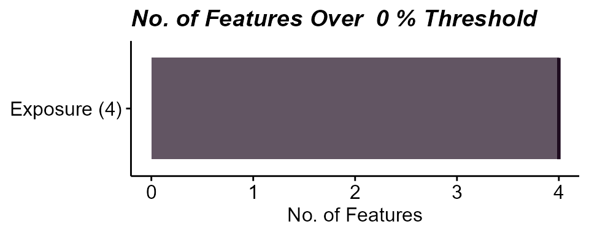

Here we see that there are 4 variables in the exposure data that are
missing data. Let’s take a look at them:

``` r
# Plot missing variables withing exposure group
plot_missing(
  exposomicset = expom,
  plot_type = "lollipop",
  threshold = 0,
  layers = "Exposure"
)
```

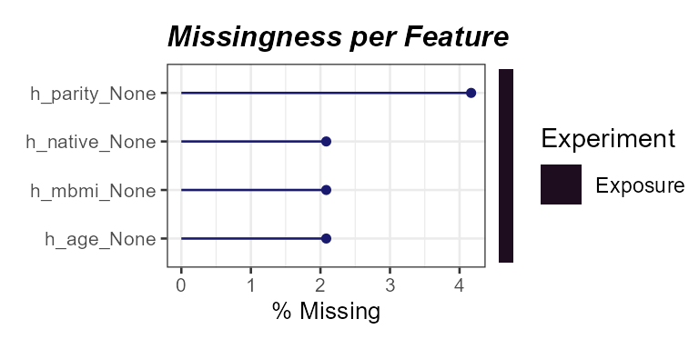

Here we see that one variable, `h_parity_None`, has about 4% missing
values. We can apply a missingness filter using the `filter_missing`
function. However, given that this level of missingness is quite low, we
will not be applying a missingness filter and instead impute the missing
data.

### Imputation

The `run_impute_missing` function is used to impute missing values. Here
we can specify the imputation method for exposure and omics data
separately.

The `exposure_impute_method` argument is used to set the imputation
method for exposure data, and the `omics_impute_method` argument is used
to set the imputation method for omics data. The `omics_to_impute`
argument is used to specify which omics data to impute. Here we will
impute the exposure data given using the `missforest` method, but other
options for imputation methods include:

- `median`: Imputes missing values with the median of the variable.

- `mean`: Imputes missing values with the mean of the variable.

- `knn`: Uses k-nearest neighbors to impute missing values.

- `mice`: Uses the Multivariate Imputation by Chained Equations (MICE)
  method to impute missing values.

- `missforest`: Uses the MissForest method to impute missing values.

- `lod_sqrt2`: Imputes missing values using the square root of the lower
  limit of detection (LOD) for each variable. This is useful for
  variables that have a lower limit of detection, such as chemical
  exposures.

``` r
# Impute missing values
expom <- run_impute_missing(
  exposomicset = expom,
  exposure_impute_method = "missforest",
  exposure_cols = exp_vars
)
```

### Normality Check

When determining variable associations, it is important to check the
normality of the data. The `run_normality_check` function is used to
check the normality of the data.

``` r
# Check variable normality
expom <- run_normality_check(
  exposomicset = expom,
  action = "add"
)
```

The `transform_exposure` function is used to transform the data to make
it more normal. Here the transform_method is set to `boxcox_best` as it
will automatically select the best transformation method based on the
data. The `transform_method` can be manually set to `log2`, `sqrt`, or
`x_1_3` as well. We specify the exposure_cols argument to set the
columns to transform.

``` r
# Transform variables
expom <- transform_exposure(
  exposomicset = expom,
  transform_method = "boxcox_best",
  exposure_cols = exp_vars
)
```

To check the normality of the exposure data, we can use the
`plot_normality_summary` function. This function plots the normality of
the data before and after transformation. The `transformed` argument is
set to `TRUE` to plot the normality status of the transformed data.

``` r
# Examine normality summary
plot_normality_summary(
  exposomicset = expom,
  transformed = TRUE
)
```

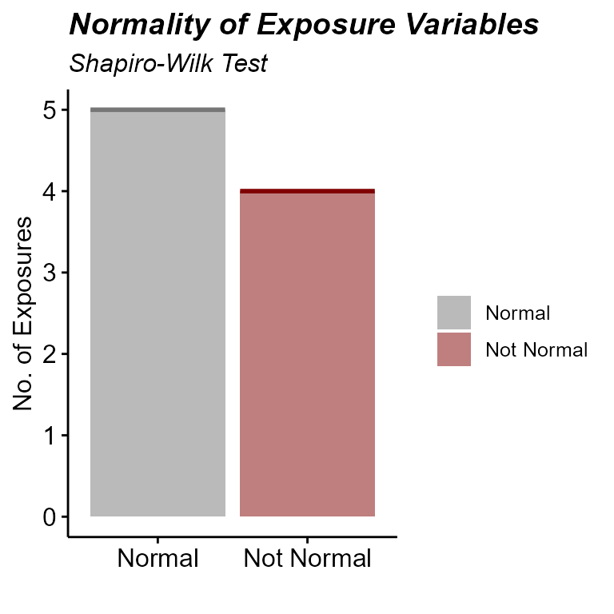

### Exposure Summary

We can summarize the exposure data using the `run_summarize_exposures`
function. This function calculates summary statistics for each exposure
variable, including the number of values, number of missing values,
minimum, maximum, range, sum, median, mean, standard error, and
confidence intervals. The `exposure_cols` argument determines which
variables to include in the summary.

``` r
# Summarize exposure data
run_summarize_exposures(
  exposomicset = expom,
  action = "get",
  exposure_cols = exp_vars
) |>
  head()
```

    ## # A tibble: 6 × 27
    ##   variable   n_values  n_na   min   max range    sum median  mean    se ci_lower
    ##   <chr>         <dbl> <dbl> <dbl> <dbl> <dbl>  <dbl>  <dbl> <dbl> <dbl>    <dbl>
    ## 1 h_pm10_ra…       48     0 16.6  25.8   9.25 1.01e3  21.3  21.0   0.31    20.4 
    ## 2 h_pm25_ra…       48     0 10.6  18.2   7.55 7.12e2  14.7  14.8   0.24    14.3 
    ## 3 hs_bpa_ma…       48     0  0     2.31  2.31 7.30e1   1.58  1.52  0.05     1.41
    ## 4 hs_mibp_c…       48     0  0.1   0.22  0.11 7.83e0   0.17  0.16  0        0.16
    ## 5 hs_pb_c_L…       48     0  1.44  5     3.56 1.59e2   3.32  3.32  0.1      3.11
    ## 6 hs_pfhxs_…       48     0  0     2.14  2.13 6.72e1   1.49  1.4   0.07     1.25
    ## # ℹ 16 more variables: ci_upper <dbl>, variance <dbl>, sd <dbl>,
    ## #   coef_var <dbl>, period <chr>, location <chr>, description <chr>,
    ## #   var_type <chr>, transformation <chr>, selected_ontology_label <chr>,
    ## #   selected_ontology_id <chr>, root_id <chr>, root_label <chr>,
    ## #   category <chr>, category_source <chr>, transformation_applied <chr>

### Exposure Visualization

------------------------------------------------------------------------

To visualize our exposure data, we can use the `plot_exposures`
function. This function allows us to plot the exposure data in a variety
of ways. Here we will plot the exposure data using a boxplot. The
`exposure_cat` argument is used to set the exposure category to plot.
Additionally, we could specify `exposure_cols` to only plot certain
exposures. The `plot_type` argument is used to set the type of plot to
create. Here we use a boxplot, but we could also use a ridge plot.

``` r
# Plot aerosol exposure distributions by sex
plot_exposures(
  exposomicset = expom,
  group_by = "e3_sex_None",
  exposure_cols = c(
    "h_pm25_ratio_preg_None",
    "h_pm10_ratio_preg_None"
  ),
  plot_type = "boxplot",
  ylab = "Values",
  title = "Aerosol Exposure by Sex"
) +
  ggpubr::stat_compare_means(label = "p.signif")
```

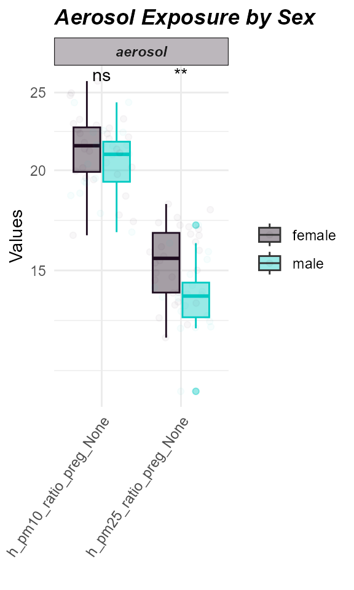

Here we see that levels of PM2.5 were higher in females compared to
males.

### Coverting the Exposomicset back to dataframes

If you need to grab your codebook, feel free to do so using the
`extract_results` function:

``` r
extract_results(
  exposomicset = expom,
  result = "codebook"
) |>
  head()
```

    ## # A tibble: 6 × 13
    ##   variable               period    location description  var_type transformation
    ##   <chr>                  <chr>     <chr>    <chr>        <chr>    <chr>         
    ## 1 h_pm10_ratio_preg_None Pregnancy Home     pm10 value … numeric  None          
    ## 2 h_pm25_ratio_preg_None Pregnancy Home     pm25 value … numeric  None          
    ## 3 hs_pm10_yr_hs_h_None   Postnatal Home     pm10 value … numeric  None          
    ## 4 hs_pm25_yr_hs_h_None   Postnatal Home     pm25 value … numeric  None          
    ## 5 h_mbmi_None            Pregnancy NA       Maternal pr… numeric  None          
    ## 6 e3_gac_None            Pregnancy NA       Gestational… numeric  None          
    ## # ℹ 7 more variables: selected_ontology_label <chr>,
    ## #   selected_ontology_id <chr>, root_id <chr>, root_label <chr>,
    ## #   category <chr>, category_source <chr>, transformation_applied <chr>

If you want to grab the exposure+metadata do so using the `pivot_sample`
function:

``` r
expom |>
  pivot_sample() |>
  head()
```

    ## # A tibble: 6 × 19
    ##   .sample e3_sex_None hs_child_age_None h_age_None h_mbmi_None e3_gac_None
    ##   <chr>   <fct>                   <dbl>      <dbl>       <dbl>       <dbl>
    ## 1 s812    female                   6.84       35          33.2        41.4
    ## 2 s296    female                   6.75       32.8        25.1        39.1
    ## 3 s242    female                   6.97       33          24.6        40.4
    ## 4 s376    male                     6.35       27.1        28.3        37  
    ## 5 s1183   female                   6.74       32.7        33.3        38.1
    ## 6 s98     female                   6.93       23          31.2        39  
    ## # ℹ 13 more variables: h_native_None <fct>, h_parity_None <fct>,
    ## #   hs_asthma <dbl>, hs_zbmi_who <dbl>, h_pm10_ratio_preg_None <dbl>,
    ## #   h_pm25_ratio_preg_None <dbl>, hs_pm10_yr_hs_h_None <dbl>,
    ## #   hs_pm25_yr_hs_h_None <dbl>, hs_pb_c_Log2 <dbl>, hs_pfhxs_m_Log2 <dbl>,
    ## #   hs_pfna_c_Log2 <dbl>, hs_bpa_madj_Log2 <dbl>, hs_mibp_cadj_Log2 <dbl>

## Exposure/Sample Clustering

### Co-exposure

Exposures rarely occur in isolation, and at any given time, we are
exposured to many different exposures. Here we provide code to see which
exposures co-occur together.

### Exposure Correlations

The `run_correlation` function identifies correlations between exposure
variables. We set `feature_type` to `exposures` to focus on exposure
variables and use a correlation cutoff of `0.3` to filter for meaningful
associations. This cutoff can be adjusted based on your data and
analysis needs.

``` r
# Run correlation analysis
expom <- run_correlation(
  exposomicset = expom,
  feature_type = "exposures",
  action = "add",
  exposure_cols = exp_vars,
  correlation_cutoff = 0
)
```

To visualize the exposure correlations, we can use the
`plot_circos_correlation` function. Here we will plot the circos plot.
This function creates a circular plot of the exposure correlations. The
`correlation_cutoff` argument is used to set the minimum correlation
score for the association. Here we use a cutoff of `0.3`.

``` r
# Plot exposure correlation circos plot
plot_circos_correlation(
  exposomicset = expom,
  feature_type = "exposures",
  corr_threshold = 0,
  exposure_cols = exp_vars
)
```

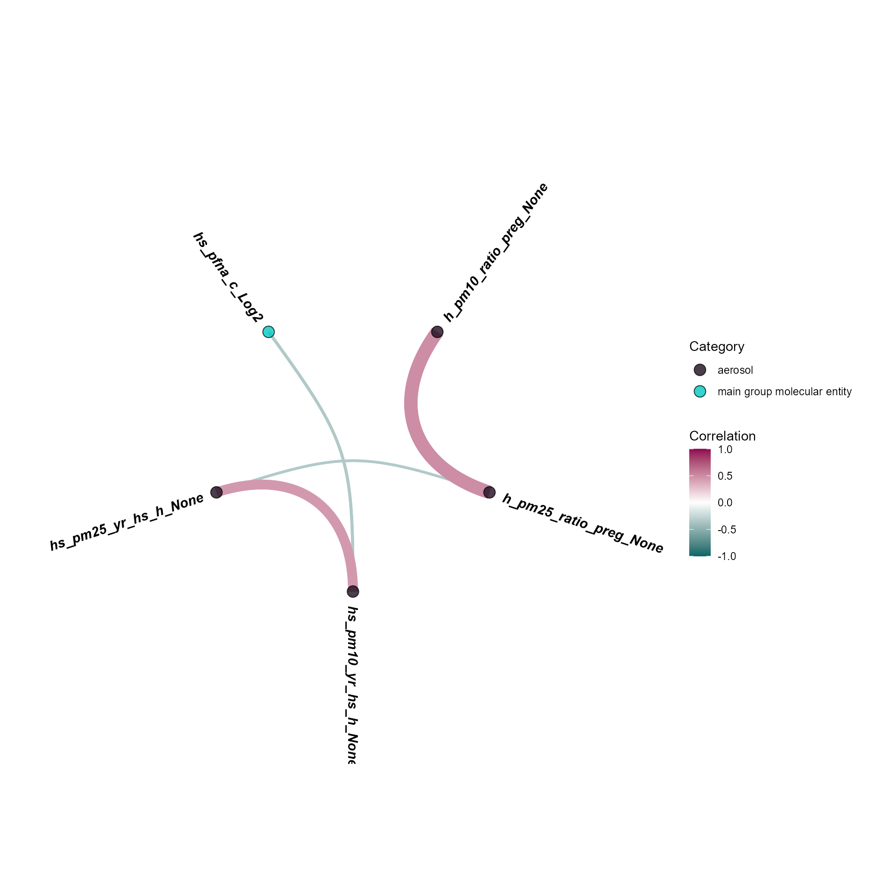

### Exposure Clusters

We can also visualize these these co-occurence patterns using a heatmap
as well. We can either specify the number of clusters or use a method
like `diana` through the `clustering_approach` argument that will decide
this for you. Here we specify two exposure groups:

``` r
# Cluster exposures and plot
expom |>
  run_cluster_exposures(
    user_k = 2,
    exposure_cols = exp_vars
  ) |>
  plot_clusters(
    exposure_cols = exp_vars,
    cluster_type = "exposure"
  )
```

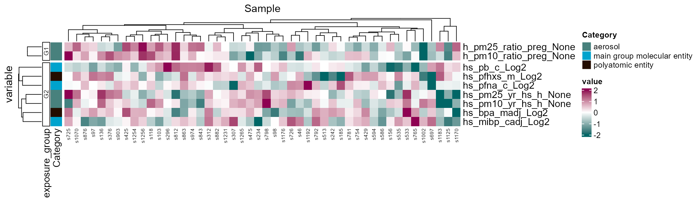

Here we note that there are two groups of exposures, mainly driven by
PM2.5 levels during pregnancy.

### Sample Clustering

We can also see this pattern by clustering samples as well:

``` r
# Cluster samples and plot
expom |>
  run_cluster_samples(
    user_k = 2,
    exposure_cols = exp_vars
  ) |>
  plot_clusters(
    exposure_cols = exp_vars,
    cluster_type = "sample"
  )
```

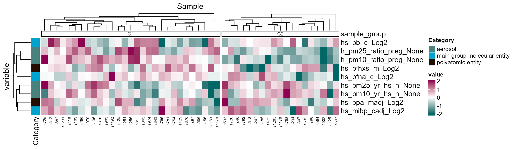

## ExWAS

### Exposome-wide association study (ExWAS)

Inspired by the concept of genome-wide association studies, or GWAS, the
ExWAS is a high-throughput way of identifying many exposures with an
association to an outcome. The `run_association` allows us to see which
exposure variables are associated with our outcome, `hs_asthma`, which
is a 0 or 1, so we set the family to `binomial`. If the variable was
continuous, we’d usually set it to `gaussian`. Just one more note: since
we are running this model on many different exposures, we use `.feature`
as a placeholder:

``` r
# Perform ExWAS
expom <- run_association(
  exposomicset = expom,
  formula = hs_asthma ~ .feature,
  source = "exposures",
  feature_set = exp_vars,
  action = "add",
  family = "binomial"
)
```

We can visualize these associations using the `plot_association`
function and set our p-value filter to color associations below that
threshold, here we set it to 0.3 just to demonstrate the coloring, but
we suggest using the `p_adjust` column for `filter_col` and a cutoff of
0.05:

``` r
# Plot the association forest plot
plot_association(
  exposomicset = expom,
  effect = "main",
  source = "exposures",
  terms = exp_vars,
  filter_thresh = 0.3,
  up_col = "#8E0152",
  down_col = "#006666",
  filter_col = "p.value",
  r2_col = "r2"
)
```

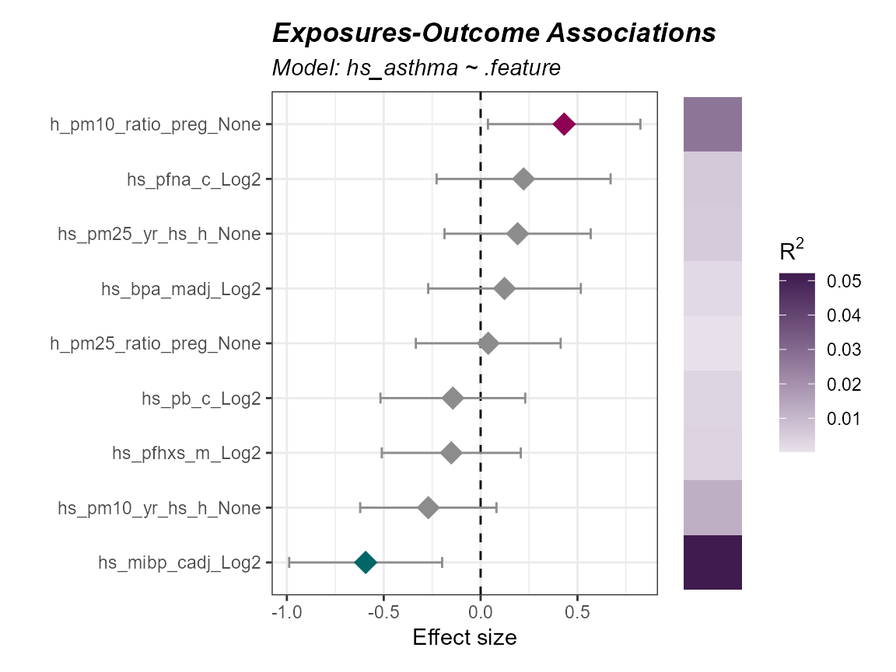

### Interaction Modeling

Sometimes, the relationship between an exposure an outcome *depends* on
another variable. For this folks tend to leverage interaction modeling.
Let’s look at how we would see if the the relationship between asthma
and an exposure depends on age:

``` r
run_association(
  exposomicset = expom,
  overwrite = TRUE,
  formula = hs_asthma ~ .feature * h_age_None,
  source = "exposures",
  feature_set = exp_vars,
  action = "add",
  family = "binomial"
) |>
  plot_association(
    effect = "h_age_None",
    source = "exposures",
    terms = exp_vars,
    filter_thresh = 0.3,
    up_col = "#8E0152",
    down_col = "#006666",
    filter_col = "p.value",
    r2_col = "r2"
  )
```

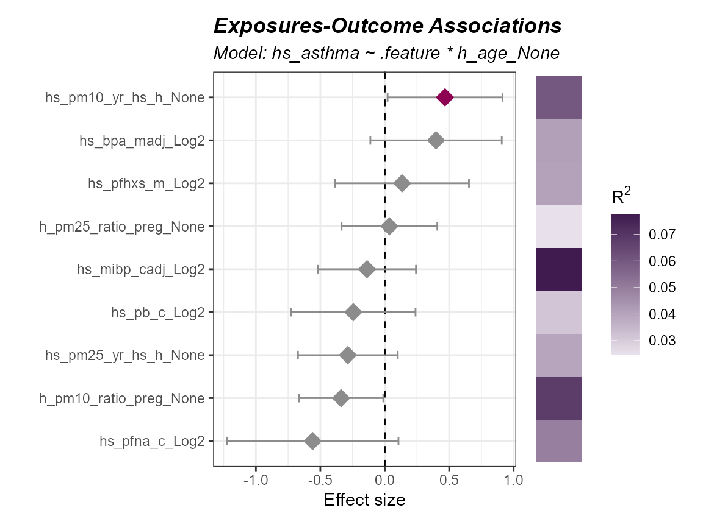

Notice, how we switched `effect = "main"` to `effect = "h_age_None"` so
that we could grab the interaction results.

### Stratifying Models

We may also want to run a model on a portion of our data, like say just
male patients:

``` r
expom |>
  run_association(
    formula = hs_asthma ~ .feature + h_age_None,
    source = "exposures",
    overwrite = TRUE,
    feature_set = exp_vars,
    family = "binomial",
    strata = "e3_sex_None",
    name = "by_sex"
  ) |>
  plot_association(
    effect = "main",
    source = "exposures",
    model = "by_sex_male",
    terms = exp_vars,
    filter_thresh = 0.3,
    up_col = "#8E0152",
    down_col = "#006666",
    filter_col = "p.value",
    r2_col = "r2"
  )
```

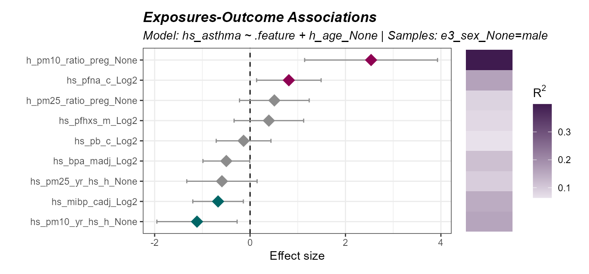

We can also filter our object with the `subset` argument. Let’s examine
the association in children with a higher BMI z-score:

``` r
expom |>
  run_association(
    formula = hs_asthma ~ .feature + h_age_None,
    source = "exposures",
    overwrite = TRUE,
    feature_set = exp_vars,
    family = "binomial",
    subset = hs_zbmi_who > 0,
    name = "high_bmi"
  ) |>
  plot_association(
    effect = "main",
    source = "exposures",
    model = "high_bmi",
    terms = exp_vars,
    filter_thresh = 0.3,
    up_col = "#8E0152",
    down_col = "#006666",
    filter_col = "p.value",
    r2_col = "r2"
  )
```

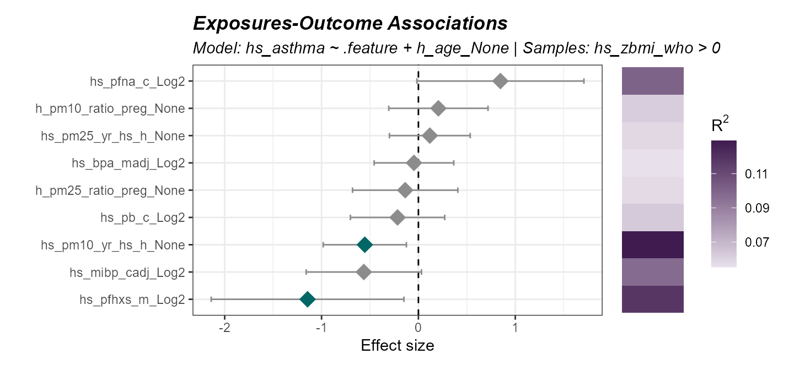

### Comparing models

Now sometimes we want to compare the results of different models. Here
we demonstrate how to make many different models using two approaches:
(1) specifying a list of formulas, and (2) using the `strata` or
`subset` functionality. This will create results for four different
models:

``` r
expom <- expom |>
  run_association(
    formula = list(
      crude = hs_asthma ~ .feature,
      adj = hs_asthma ~ .feature + h_age_None
    ),
    source = "exposures",
    overwrite = TRUE,
    feature_set = exp_vars,
    family = "binomial"
  ) |>
  run_association(
    formula = hs_asthma ~ .feature + h_age_None,
    source = "exposures",
    feature_set = exp_vars,
    family = "binomial",
    strata = "e3_sex_None",
    name = "by_sex"
  )
```

To see what model results are available you can use the following:

``` r
association_models(expom)
```

    ## # A tibble: 5 × 8
    ##   source    model         formula     subset stratum family n_samples n_features
    ##   <chr>     <chr>         <chr>       <chr>  <chr>   <chr>      <int>      <int>
    ## 1 exposures default       hs_asthma … NA     NA      binom…        48          9
    ## 2 exposures crude         hs_asthma … NA     NA      binom…        48          9
    ## 3 exposures adj           hs_asthma … NA     NA      binom…        48          9
    ## 4 exposures by_sex_female hs_asthma … NA     female  binom…        28          9
    ## 5 exposures by_sex_male   hs_asthma … NA     male    binom…        20          9

Now let’s demonstrate how to compare two models, here we will compare
effect estimates for males and females:

``` r
expom |>
  compare_association(
    "exposures",
    models = c(
      "by_sex_female",
      "by_sex_male"
    )
  ) |>
  plot_association_comparison(type = "forest")
```

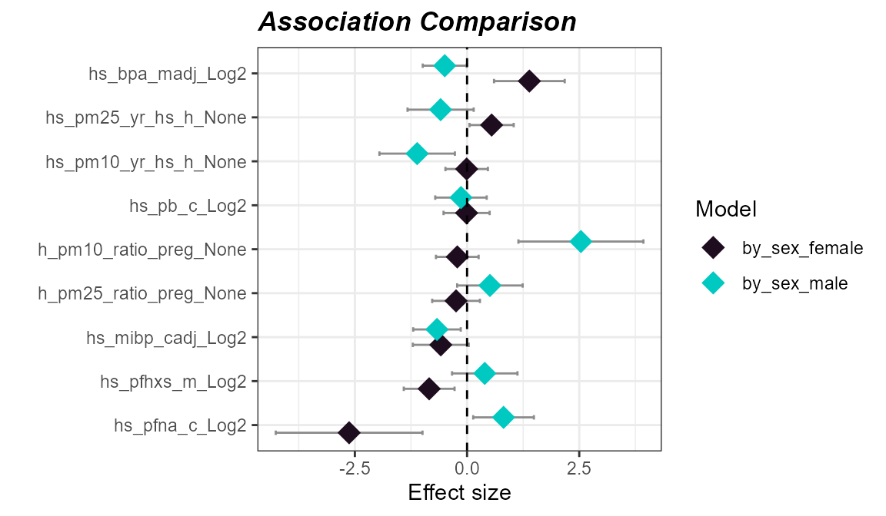

We could also choose to visualize it using a scatter plot:

``` r
expom |>
  compare_association(
    "exposures",
    models = c(
      "by_sex_female",
      "by_sex_male"
    )
  ) |>
  plot_association_comparison(type = "scatter")
```

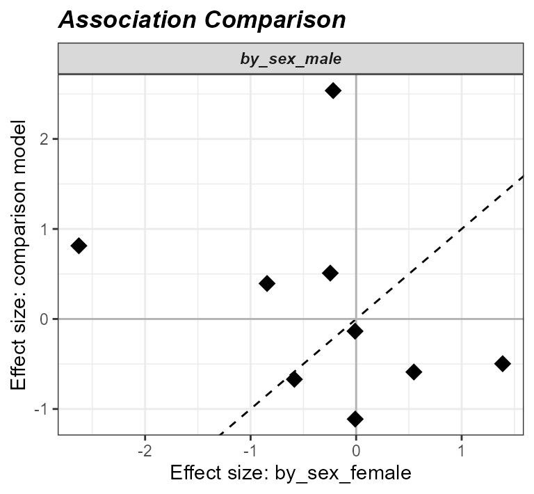

Here we see that the effect estimates are not correlated with one
another, suggesting that the relationship between asthma and exposure
differs by sex.

## Exposome Scores

### Exposome Scores

------------------------------------------------------------------------

We can calculate exposome scores, which are a summary measure of
exposure. The `run_exposome_score` function is used to calculate the
exposome score. The `exposure_cols` argument is used to set the columns
to use for the exposome score. The `score_type` argument is used to set
the type of score to calculate. Here we could use:

- `median`: Calculates the median of the exposure variables.

- `mean`: Calculates the mean of the exposure variables.

- `sum`: Calculates the sum of the exposure variables.

- `pca`: Calculates the first principal component of the exposure
  variables.

- `irt`: Uses Item Response Theory to calculate the exposome score.

- `quantile`: Calculates the quantile of the exposure variables.

- `var`: Calculates the variance of the exposure variables.

The `score_column_name` argument is used to set the name of the column
to store the exposome score in. Here we will define a score for aerosols
using a variety of different methods and demonstrate their use in
association with asthma status.

``` r
# determine which aerosol variables to use
aerosols <- c("h_pm25_ratio_preg_None", "h_pm10_ratio_preg_None")

# Create exposome scores
expom <- expom |>
  run_exposome_score(
    exposure_cols = aerosols,
    score_type = "median",
    score_column_name = "exposome_median_score"
  ) |>
  run_exposome_score(
    exposure_cols = aerosols,
    score_type = "pca",
    score_column_name = "exposome_pca_score"
  ) |>
  run_exposome_score(
    exposure_cols = aerosols,
    score_type = "quantile",
    score_column_name = "exposome_quantile_score"
  ) |>
  run_exposome_score(
    exposure_cols = aerosols,
    score_type = "var",
    score_column_name = "exposome_var_score"
  )
```

We can then associate these exposome scores with asthma status using the
`run_association` function, just like we did before. However, this time
we specify our `feature_set` to be the exposome scores we just
calculated.

``` r
# Associate exposome scores with outcome
expom <- run_association(
  exposomicset = expom,
  formula = hs_asthma ~ .feature,
  source = "exposures",
  feature_set = c(
    "exposome_median_score",
    "exposome_pca_score",
    "exposome_quantile_score",
    "exposome_var_score"
  ),
  action = "add",
  family = "binomial",
  name = "exposome_scores"
)
```

``` r
# Plot the association forest plot
plot_association(
  exposomicset = expom,
  source = "exposures",
  terms = c(
    "exposome_median_score",
    "exposome_pca_score",
    "exposome_quantile_score",
    "exposome_var_score"
  ),
  model = "exposome_scores",
  filter_col = "p.value",
  filter_thresh = 0.05,
  r2_col = "r2"
)
```

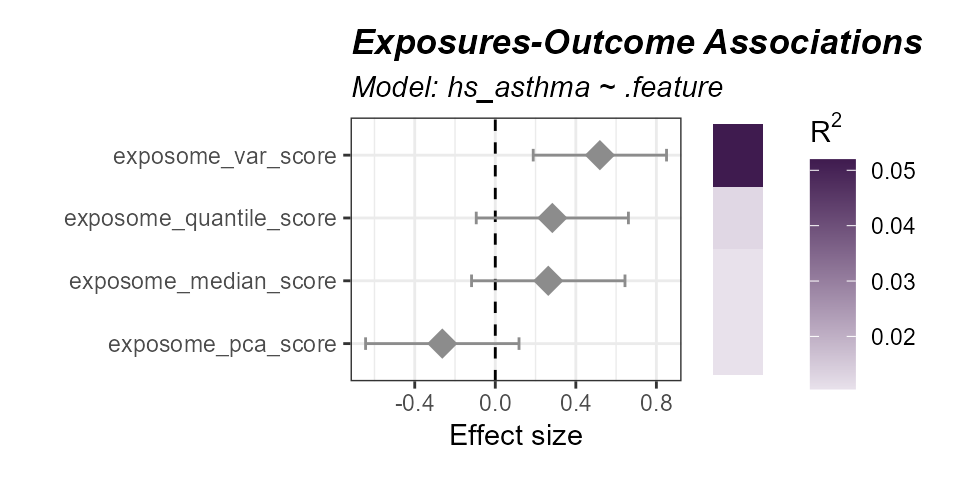

Session Info

``` r
sessionInfo()
```

    ## R version 4.5.1 (2025-06-13 ucrt)
    ## Platform: x86_64-w64-mingw32/x64
    ## Running under: Windows 11 x64 (build 26200)
    ## 
    ## Matrix products: default
    ##   LAPACK version 3.12.1
    ## 
    ## locale:
    ## [1] LC_COLLATE=English_United States.utf8 
    ## [2] LC_CTYPE=English_United States.utf8   
    ## [3] LC_MONETARY=English_United States.utf8
    ## [4] LC_NUMERIC=C                          
    ## [5] LC_TIME=English_United States.utf8    
    ## 
    ## time zone: America/New_York
    ## tzcode source: internal
    ## 
    ## attached base packages:
    ## [1] stats4    stats     graphics  grDevices utils     datasets  methods  
    ## [8] base     
    ## 
    ## other attached packages:
    ##  [1] tidyexposomics_1.1.3        MultiAssayExperiment_1.36.2
    ##  [3] SummarizedExperiment_1.40.0 Biobase_2.70.0             
    ##  [5] GenomicRanges_1.62.1        Seqinfo_1.0.0              
    ##  [7] IRanges_2.44.0              S4Vectors_0.48.0           
    ##  [9] BiocGenerics_0.56.0         generics_0.1.4             
    ## [11] MatrixGenerics_1.22.0       matrixStats_1.5.0          
    ## [13] BiocStyle_2.38.0           
    ## 
    ## loaded via a namespace (and not attached):
    ##   [1] later_1.4.8           filelock_1.0.3        tibble_3.3.0         
    ##   [4] polyclip_1.10-7       rpart_4.1.24          factoextra_2.2.0     
    ##   [7] tidyHeatmap_1.13.1    lifecycle_1.0.5       httr2_1.3.0          
    ##  [10] Rdpack_2.6.6          rstatix_1.1.0         doParallel_1.0.17    
    ##  [13] lattice_0.22-7        MASS_7.3-65           dendextend_1.19.1    
    ##  [16] backports_1.5.1       magrittr_2.0.4        limma_3.66.0         
    ##  [19] Hmisc_5.2-6           sass_0.4.10           rmarkdown_2.31       
    ##  [22] jquerylib_0.1.4       yaml_2.3.12           httpuv_1.6.17        
    ##  [25] otel_0.2.0            doRNG_1.8.6.3         DBI_1.3.0            
    ##  [28] RColorBrewer_1.1-3    abind_1.4-8           Rtsne_0.17           
    ##  [31] purrr_1.2.2           ggraph_2.2.2          itertools_0.1-3      
    ##  [34] nnet_7.3-20           tweenr_2.0.3          circlize_0.4.18      
    ##  [37] ggrepel_0.9.8         fenr_1.8.2            missForest_1.6.1     
    ##  [40] pkgdown_2.2.1         codetools_0.2-20      DelayedArray_0.36.0  
    ##  [43] DT_0.34.0             ggforce_0.5.0         shape_1.4.6.1        
    ##  [46] tidyselect_1.2.1      farver_2.1.2          viridis_0.6.5        
    ##  [49] dynamicTreeCut_1.63-1 BiocFileCache_3.0.0   base64enc_0.1-6      
    ##  [52] jsonlite_2.0.0        GetoptLong_1.1.1      tidygraph_1.3.1      
    ##  [55] Formula_1.2-6         ggridges_0.5.7        iterators_1.0.14     
    ##  [58] systemfonts_1.3.2     foreach_1.5.2         tools_4.5.1          
    ##  [61] ragg_1.5.2            Rcpp_1.1.1            glue_1.8.0           
    ##  [64] gridExtra_2.3.1       SparseArray_1.10.8    BiocBaseUtils_1.12.0 
    ##  [67] xfun_0.60             ranger_0.18.0         dplyr_1.2.1          
    ##  [70] withr_3.0.3           BiocManager_1.30.27   fastmap_1.2.0        
    ##  [73] ggh4x_0.3.1           digest_0.6.39         R6_2.6.1             
    ##  [76] mime_0.13             visdat_0.6.0          textshaping_1.0.5    
    ##  [79] colorspace_2.1-3      Cairo_1.7-0           RSQLite_3.53.3       
    ##  [82] utf8_1.2.6            tidyr_1.3.2           ggsci_5.2.0          
    ##  [85] data.table_1.18.2.1   FNN_1.1.4.1           graphlayouts_1.2.5   
    ##  [88] httr_1.4.8            htmlwidgets_1.6.4     S4Arrays_1.10.1      
    ##  [91] pkgconfig_2.0.3       gtable_0.3.6          blob_1.3.0           
    ##  [94] ComplexHeatmap_2.26.1 S7_0.2.1              XVector_0.50.0       
    ##  [97] htmltools_0.5.9       carData_3.0-6         bookdown_0.47        
    ## [100] naniar_1.1.0          clue_0.3-68           scales_1.4.0         
    ## [103] png_0.1-9             knitr_1.51            rstudioapi_0.19.0    
    ## [106] tzdb_0.5.0            rjson_0.2.23          checkmate_2.3.4      
    ## [109] curl_7.0.0            cachem_1.1.0          GlobalOptions_0.1.4  
    ## [112] stringr_1.6.0         parallel_4.5.1        foreign_0.8-90       
    ## [115] desc_1.4.3            pillar_1.11.1         grid_4.5.1           
    ## [118] vctrs_0.7.3           promises_1.5.0        randomForest_4.7-1.2 
    ## [121] ggpubr_1.0.0          car_3.1-5             dbplyr_2.6.0         
    ## [124] xtable_1.8-8          cluster_2.1.8.3       htmlTable_2.5.0      
    ## [127] evaluate_1.0.5        magick_2.9.1          readr_2.2.0          
    ## [130] cli_3.6.5             compiler_4.5.1        rlang_1.3.0          
    ## [133] crayon_1.5.3          rngtools_1.5.2        ggsignif_0.6.4       
    ## [136] labeling_0.4.3        densityClust_0.3.3    tidybulk_2.0.1       
    ## [139] forcats_1.0.1         fs_2.1.0              stringi_1.8.7        
    ## [142] viridisLite_0.4.3     assertthat_0.2.1      Matrix_1.7-4         
    ## [145] hms_1.1.4             patchwork_1.3.2       bit64_4.8.2          
    ## [148] ggplot2_4.0.3         statmod_1.5.2         shiny_1.14.0         
    ## [151] rbibutils_2.4.1       igraph_2.3.3          broom_1.0.13         
    ## [154] memoise_2.0.1         bslib_0.12.0          bit_4.6.0
