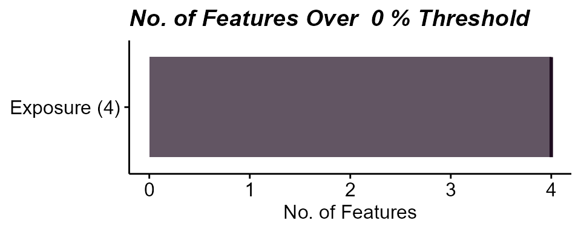
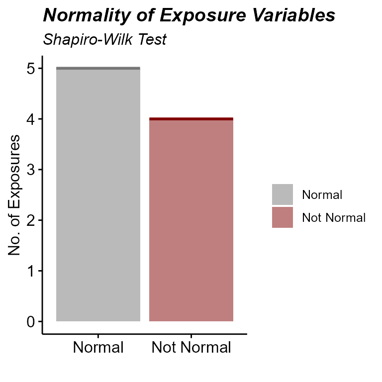
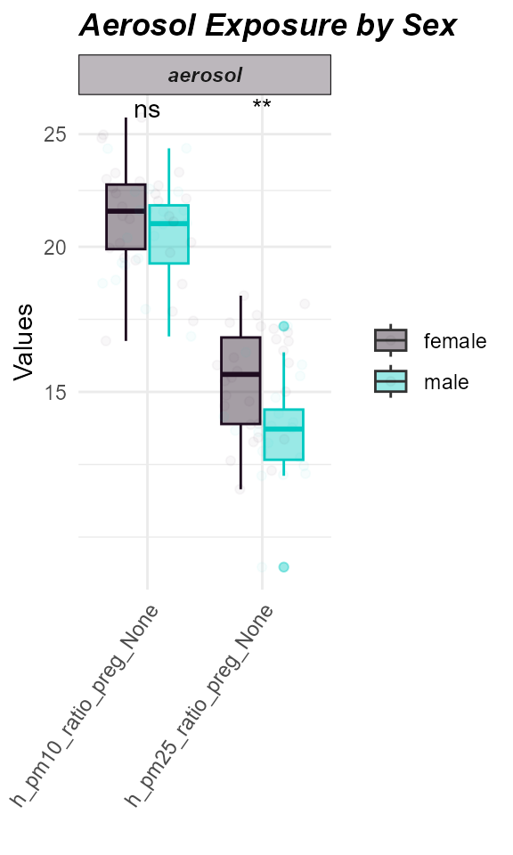

# Exposure Preprocessing

[Previous: Exposure
Ontology](https://BioNomad.github.io/tidyexposomics/articles/exposure_annotation.md)

**Objectives**

- Create an `exposomicset` object from a codebook and exposure metadata.
- Identify and visualize missing values in exposure data.
- Impute missing exposure values.
- Assess variable normality and apply transformations to improve it.

### Getting the data in order

To get started with an exposure-outcome-only workflow, we need to create
our exposomicset which stores this data:

``` r
# Load Libraries
library(tidyverse)
library(tidyexposomics)

# Load example data
data("tidyexposomics_example")

# Create exposomic set object
expom <- create_exposomicset(
    codebook = tidyexposomics_example$annotated_cb,
    exposure = tidyexposomics_example$meta
)
```

You’ll notice it took two inputs, (1) a codebook with information about
the exposures ([see more about codebooks
here](https://BioNomad.github.io/tidyexposomics/articles/exposure_annotation.md)),
and (2) the meta data which contain the exposures and covariate
information.

For the sake of simplicity we will focus on a short list of exposures:

``` r
# Grab exposure variables
exp_vars <- tidyexposomics_example$annotated_cb |>
    filter(category %in% c(
        "aerosol",
        "main group molecular entity",
        "polyatomic entity"
    )) |>
    pull(variable) |>
    as.character()
```

## Quality Control

------------------------------------------------------------------------

### Missingness

Oftentimes when collecting data, there are missing values. Let’s use the
`plot_missing` function to determine where our missing values are:

``` r
# Plot the missingness summary
plot_missing(
    exposomicset = expom,
    plot_type = "summary",
    threshold = 0
)
```



Here we see that there are 4 variables in the exposure data that are
missing data. Let’s take a look at them:

``` r
# Plot missing variables withing exposure group
plot_missing(
    exposomicset = expom,
    plot_type = "lollipop",
    threshold = 0,
    layers = "Exposure"
)
```


Percent missingness per exposure variable. Parity, `h_parity_None`,
shows the highest missingness.

Here we see that one variable, `h_parity_None`, has about 4% missing
values. We can apply a missingness filter using the `filter_missing`
function. However, given that this level of missingness is quite low, we
will not be applying a missingness filter and instead impute the missing
data.

### Imputation

The `run_impute_missing` function is used to impute missing values. Here
we can specify the imputation method for exposure and omics data
separately.

The `exposure_impute_method` argument is used to set the imputation
method for exposure data, and the `omics_impute_method` argument is used
to set the imputation method for omics data. The `omics_to_impute`
argument is used to specify which omics data to impute. Here we will
impute the exposure data given using the `missforest` method, but other
options for imputation methods include:

- `median`: Imputes missing values with the median of the variable.

- `mean`: Imputes missing values with the mean of the variable.

- `knn`: Uses k-nearest neighbors to impute missing values.

- `mice`: Uses the Multivariate Imputation by Chained Equations (MICE)
  method to impute missing values.

- `missforest`: Uses the MissForest method to impute missing values.

- `lod_sqrt2`: Imputes missing values using the square root of the lower
  limit of detection (LOD) for each variable. This is useful for
  variables that have a lower limit of detection, such as chemical
  exposures.

``` r
# Impute missing values
expom <- run_impute_missing(
    exposomicset = expom,
    exposure_impute_method = "missforest",
    exposure_cols = exp_vars
)
```

### Normality Check

When determining variable associations, it is important to check the
normality of the data. The `run_normality_check` function is used to
check the normality of the data.

``` r
# Check variable normality
expom <- run_normality_check(
    exposomicset = expom,
    action = "add"
)
```

The `transform_exposure` function is used to transform the data to make
it more normal. Here the transform_method is set to `boxcox_best` as it
will automatically select the best transformation method based on the
data. The `transform_method` can be manually set to `log2`, `sqrt`, or
`x_1_3` as well. We specify the exposure_cols argument to set the
columns to transform.

``` r
# Transform variables
expom <- transform_exposure(
    exposomicset = expom,
    transform_method = "boxcox_best",
    exposure_cols = exp_vars
)
```

To check the normality of the exposure data, we can use the
`plot_normality_summary` function. This function plots the normality of
the data before and after transformation. The `transformed` argument is
set to `TRUE` to plot the normality status of the transformed data.

``` r
# Examine normality summary
plot_normality_summary(
    exposomicset = expom,
    transformed = TRUE
)
```



### Exposure Summary

We can summarize the exposure data using the `run_summarize_exposures`
function. This function calculates summary statistics for each exposure
variable, including the number of values, number of missing values,
minimum, maximum, range, sum, median, mean, standard error, and
confidence intervals. The `exposure_cols` argument determines which
variables to include in the summary.

``` r
# Summarize exposure data
run_summarize_exposures(
    exposomicset = expom,
    action = "get",
    exposure_cols = exp_vars
) |>
    head()
```

    ## # A tibble: 6 × 27
    ##   variable   n_values  n_na   min   max range    sum median  mean    se ci_lower
    ##   <chr>         <dbl> <dbl> <dbl> <dbl> <dbl>  <dbl>  <dbl> <dbl> <dbl>    <dbl>
    ## 1 h_pm10_ra…       48     0 16.6  25.8   9.25 1.01e3  21.3  21.0   0.31    20.4 
    ## 2 h_pm25_ra…       48     0 10.6  18.2   7.55 7.12e2  14.7  14.8   0.24    14.3 
    ## 3 hs_bpa_ma…       48     0  0     2.31  2.31 7.30e1   1.58  1.52  0.05     1.41
    ## 4 hs_mibp_c…       48     0  0.1   0.22  0.11 7.83e0   0.17  0.16  0        0.16
    ## 5 hs_pb_c_L…       48     0  1.44  5     3.56 1.59e2   3.32  3.32  0.1      3.11
    ## 6 hs_pfhxs_…       48     0  0     2.14  2.13 6.72e1   1.49  1.4   0.07     1.25
    ## # ℹ 16 more variables: ci_upper <dbl>, variance <dbl>, sd <dbl>,
    ## #   coef_var <dbl>, period <chr>, location <chr>, description <chr>,
    ## #   var_type <chr>, transformation <chr>, selected_ontology_label <chr>,
    ## #   selected_ontology_id <chr>, root_id <chr>, root_label <chr>,
    ## #   category <chr>, category_source <chr>, transformation_applied <chr>

### Exposure Visualization

------------------------------------------------------------------------

To visualize our exposure data, we can use the `plot_exposures`
function. This function allows us to plot the exposure data in a variety
of ways. Here we will plot the exposure data using a boxplot. The
`exposure_cat` argument is used to set the exposure category to plot.
Additionally, we could specify `exposure_cols` to only plot certain
exposures. The `plot_type` argument is used to set the type of plot to
create. Here we use a boxplot, but we could also use a ridge plot.

``` r
# Plot aerosol exposure distributions by sex
plot_exposures(
    exposomicset = expom,
    group_by = "e3_sex_None",
    exposure_cols = c(
      "h_pm25_ratio_preg_None",
      "h_pm10_ratio_preg_None"
    ),
    plot_type = "boxplot",
    ylab = "Values",
    title = "Aerosol Exposure by Sex"
)+
  ggpubr::stat_compare_means(label="p.signif")
```



Here we see that levels of PM2.5 were higher in females compared to
males.

### Coverting the Exposomicset back to dataframes

If you need to grab your codebook, feel free to do so using the
`extract_results` function:

``` r
extract_results(
  exposomicset = expom,
  result ="codebook") |> 
  head()
```

    ## # A tibble: 6 × 13
    ##   variable               period    location description  var_type transformation
    ##   <chr>                  <chr>     <chr>    <chr>        <chr>    <chr>         
    ## 1 h_pm10_ratio_preg_None Pregnancy Home     pm10 value … numeric  None          
    ## 2 h_pm25_ratio_preg_None Pregnancy Home     pm25 value … numeric  None          
    ## 3 hs_pm10_yr_hs_h_None   Postnatal Home     pm10 value … numeric  None          
    ## 4 hs_pm25_yr_hs_h_None   Postnatal Home     pm25 value … numeric  None          
    ## 5 h_mbmi_None            Pregnancy NA       Maternal pr… numeric  None          
    ## 6 e3_gac_None            Pregnancy NA       Gestational… numeric  None          
    ## # ℹ 7 more variables: selected_ontology_label <chr>,
    ## #   selected_ontology_id <chr>, root_id <chr>, root_label <chr>,
    ## #   category <chr>, category_source <chr>, transformation_applied <chr>

If you want to grab the exposure+metadata do so using the `pivot_sample`
function:

``` r
expom |> 
  pivot_sample() |> 
  head()
```

    ## # A tibble: 6 × 19
    ##   .sample e3_sex_None hs_child_age_None h_age_None h_mbmi_None e3_gac_None
    ##   <chr>   <fct>                   <dbl>      <dbl>       <dbl>       <dbl>
    ## 1 s812    female                   6.84       35          33.2        41.4
    ## 2 s296    female                   6.75       32.8        25.1        39.1
    ## 3 s242    female                   6.97       33          24.6        40.4
    ## 4 s376    male                     6.35       27.1        28.3        37  
    ## 5 s1183   female                   6.74       32.7        33.3        38.1
    ## 6 s98     female                   6.93       23          31.2        39  
    ## # ℹ 13 more variables: h_native_None <fct>, h_parity_None <fct>,
    ## #   hs_asthma <dbl>, hs_zbmi_who <dbl>, h_pm10_ratio_preg_None <dbl>,
    ## #   h_pm25_ratio_preg_None <dbl>, hs_pm10_yr_hs_h_None <dbl>,
    ## #   hs_pm25_yr_hs_h_None <dbl>, hs_pb_c_Log2 <dbl>, hs_pfhxs_m_Log2 <dbl>,
    ## #   hs_pfna_c_Log2 <dbl>, hs_bpa_madj_Log2 <dbl>, hs_mibp_cadj_Log2 <dbl>

[Next: Exposure/Sample
Clustering](https://BioNomad.github.io/tidyexposomics/articles/exposure_sample_clustering.md)
