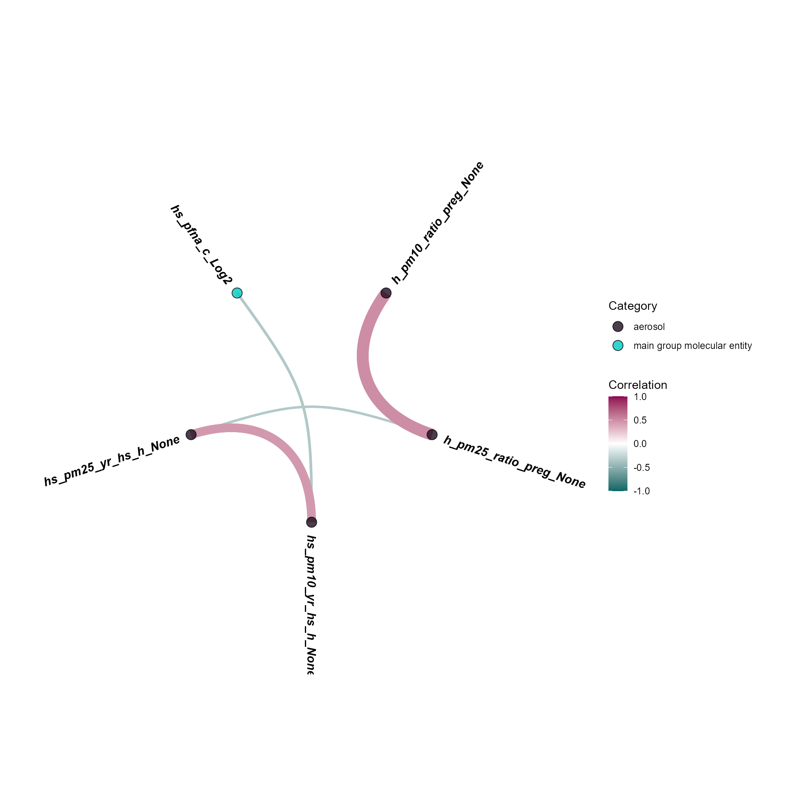
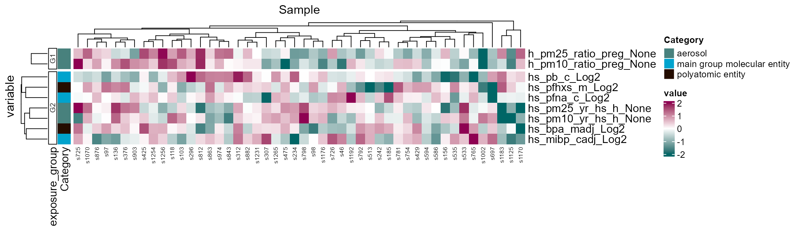
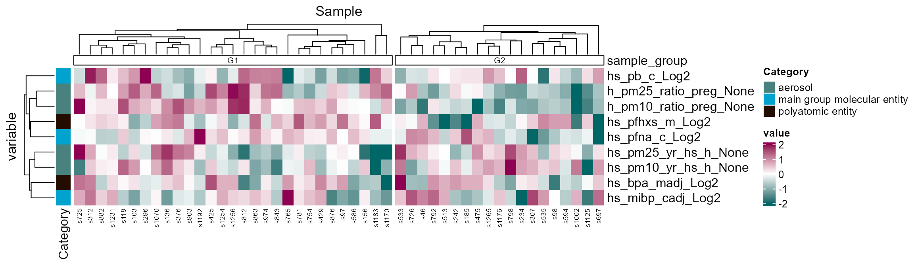

# Exposure/Sample Clustering

[Previous: Exposure
Preprocessing](https://BioNomad.github.io/tidyexposomics/articles/exposure_preprocessing.md)

**Objectives**

- Understand which exposures/samples are correlated with one another.
- Determine if exposures/samples cluster into groups.

## Co-exposure

Exposures rarely occur in isolation, and at any given time, we are
exposured to many different exposures. Here we provide code to see which
exposures co-occur together.

## Prerequisites

We covered [exposure
preprocessing](https://BioNomad.github.io/tidyexposomics/articles/exposure_preprocessing.md)
in a previous vignette. Here is the quick start code from that vignette
to get you going:

Click to expand code

``` r
# Load Libraries
library(tidyverse)
library(tidyexposomics)

# Load example data
data("tidyexposomics_example")

# Create exposomic set object
expom <- create_exposomicset(
    codebook = tidyexposomics_example$annotated_cb,
    exposure = tidyexposomics_example$meta
)

# Grab exposure variables
exp_vars <- tidyexposomics_example$annotated_cb |>
    filter(category %in% c(
        "aerosol",
        "main group molecular entity",
        "polyatomic entity"
    )) |>
    pull(variable) |>
    as.character()

# Impute missing values
expom <- run_impute_missing(
    exposomicset = expom,
    exposure_impute_method = "missforest",
    exposure_cols = exp_vars
)

# Check variable normality
expom <- run_normality_check(
    exposomicset = expom,
    action = "add"
)

# Transform variables
expom <- transform_exposure(
    exposomicset = expom,
    transform_method = "boxcox_best",
    exposure_cols = exp_vars
)
```

## Exposure Correlations

The `run_correlation` function identifies correlations between exposure
variables. We set `feature_type` to `exposures` to focus on exposure
variables and use a correlation cutoff of `0.3` to filter for meaningful
associations. This cutoff can be adjusted based on your data and
analysis needs.

``` r
# Run correlation analysis
expom <- run_correlation(
    exposomicset = expom,
    feature_type = "exposures",
    action = "add",
    exposure_cols = exp_vars,
    correlation_cutoff = 0
)
```

To visualize the exposure correlations, we can use the
`plot_circos_correlation` function. Here we will plot the circos plot.
This function creates a circular plot of the exposure correlations. The
`correlation_cutoff` argument is used to set the minimum correlation
score for the association. Here we use a cutoff of `0.3`.

``` r
# Plot exposure correlation circos plot
plot_circos_correlation(
    exposomicset = expom,
    feature_type = "exposures",
    corr_threshold = 0,
    exposure_cols = exp_vars
)
```



## Exposure Clusters

We can also visualize these these co-occurence patterns using a heatmap
as well. We can either specify the number of clusters or use a method
like `diana` through the `clustering_approach` argument that will decide
this for you. Here we specify two exposure groups:

``` r
# Cluster exposures and plot
expom |> 
  run_cluster_exposures(
    user_k = 2,
    exposure_cols = exp_vars) |>
  plot_clusters(
    exposure_cols = exp_vars,
    cluster_type = "exposure")
```



Here we note that there are two groups of exposures, mainly driven by
PM2.5 levels during pregnancy.

## Sample Clustering

We can also see this pattern by clustering samples as well:

``` r
# Cluster samples and plot
expom |> 
  run_cluster_samples(
    user_k = 2,
    exposure_cols = exp_vars) |>
  plot_clusters(
    exposure_cols = exp_vars,
    cluster_type = "sample")
```



[Next:
ExWAS](https://BioNomad.github.io/tidyexposomics/articles/exwas.md)
