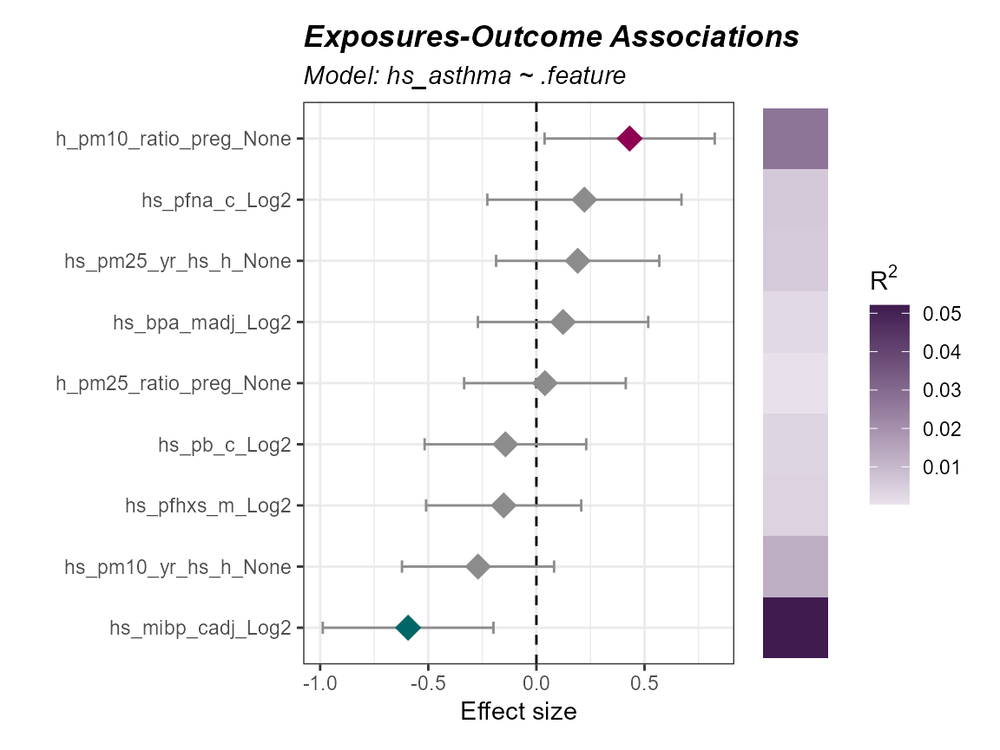
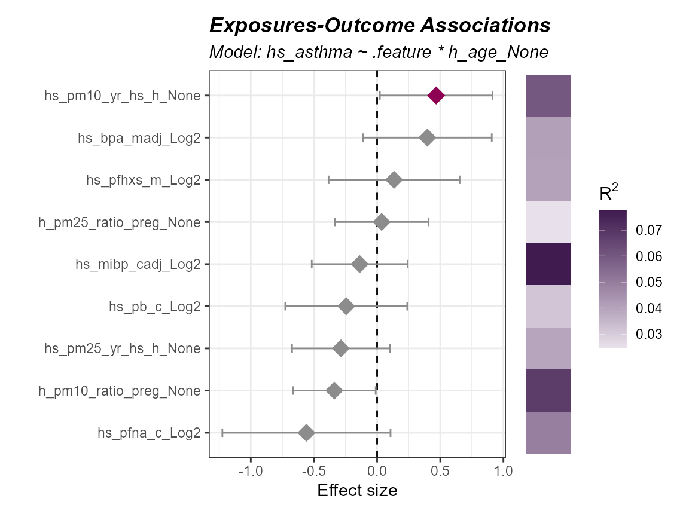
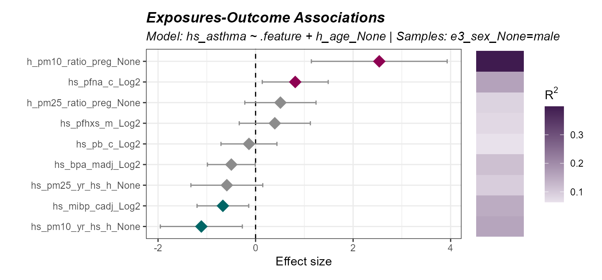
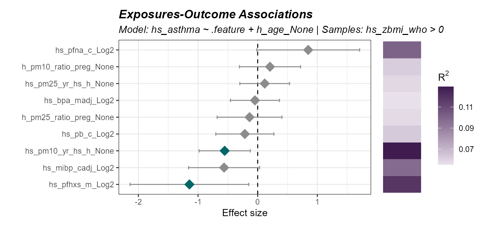
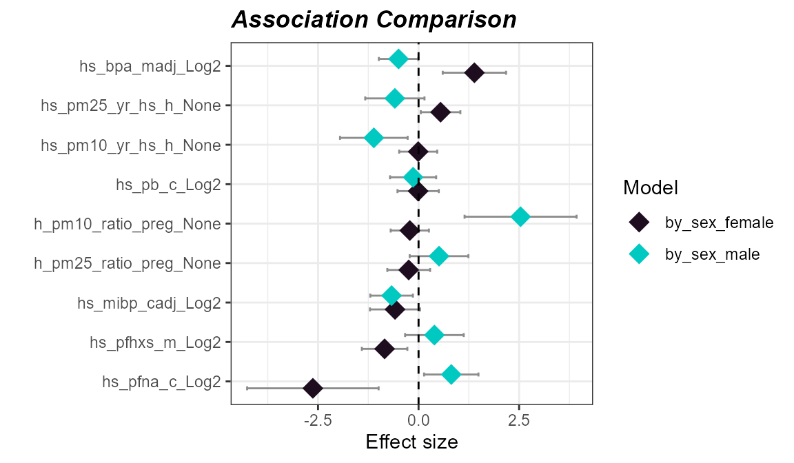
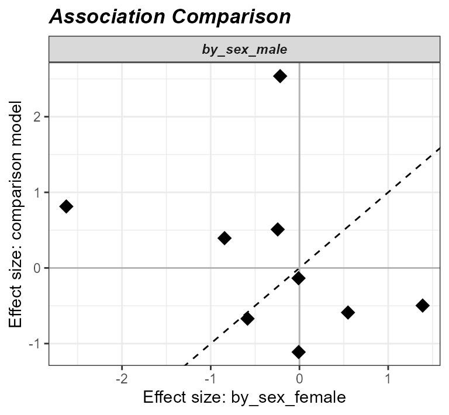

# ExWAS

[Previous: Exposure/Sample
Clustering](https://BioNomad.github.io/tidyexposomics/articles/exposure_sample_clustering.md)

**Objectives**

- Run an exposome-wide association study (ExWAS) to test many exposures
  against a single outcome.
- Fit interaction models to test whether an exposure-outcome
  relationship depends on another variable.
- Stratify models or subset samples to examine specific subgroups.
- Compare effect estimates across models.

## Prerequisites

We covered [exposure
preprocessing](https://BioNomad.github.io/tidyexposomics/articles/exposure_preprocessing.md)
in a previous vignette. Here is the quick start code from that vignette
to get you going:

Click to expand code

``` r
# Load Libraries
library(tidyverse)
library(tidyexposomics)

# Load example data
data("tidyexposomics_example")

# Create exposomic set object
expom <- create_exposomicset(
    codebook = tidyexposomics_example$annotated_cb,
    exposure = tidyexposomics_example$meta
)

# Grab exposure variables
exp_vars <- tidyexposomics_example$annotated_cb |>
    filter(category %in% c(
        "aerosol",
        "main group molecular entity",
        "polyatomic entity"
    )) |>
    pull(variable) |>
    as.character()

# Impute missing values
expom <- run_impute_missing(
    exposomicset = expom,
    exposure_impute_method = "missforest",
    exposure_cols = exp_vars
)

# Check variable normality
expom <- run_normality_check(
    exposomicset = expom,
    action = "add"
)

# Transform variables
expom <- transform_exposure(
    exposomicset = expom,
    transform_method = "boxcox_best",
    exposure_cols = exp_vars
)
```

## Exposome-wide association study (ExWAS)

Inspired by the concept of genome-wide association studies, or GWAS, the
ExWAS is a high-throughput way of identifying many exposures with an
association to an outcome. The `run_association` allows us to see which
exposure variables are associated with our outcome, `hs_asthma`, which
is a 0 or 1, so we set the family to `binomial`. If the variable was
continuous, we’d usually set it to `gaussian`. Just one more note: since
we are running this model on many different exposures, we use `.feature`
as a placeholder:

``` r
# Perform ExWAS
expom <- run_association(
    exposomicset = expom,
    formula = hs_asthma ~ .feature,
    source = "exposures",
    feature_set = exp_vars,
    action = "add",
    family = "binomial"
)
```

We can visualize these associations using the `plot_association`
function and set our p-value filter to color associations below that
threshold, here we set it to 0.3 just to demonstrate the coloring, but
we suggest using the `p_adjust` column for `filter_col` and a cutoff of
0.05:

``` r
# Plot the association forest plot
plot_association(
    exposomicset = expom,
    effect = "main",
    source = "exposures",
    terms = exp_vars,
    filter_thresh = 0.3,
    up_col = "#8E0152",
    down_col = "#006666",
    filter_col = "p.value",
    r2_col = "r2"
)
```



## Interaction Modeling

Sometimes, the relationship between an exposure an outcome *depends* on
another variable. For this folks tend to leverage interaction modeling.
Let’s look at how we would see if the the relationship between asthma
and an exposure depends on age:

``` r
run_association(
    exposomicset = expom,
    overwrite = TRUE,
    formula = hs_asthma ~ .feature * h_age_None,
    source = "exposures",
    feature_set = exp_vars,
    action = "add",
    family = "binomial"
) |> 
  plot_association(
    effect = "h_age_None",
    source = "exposures",
    terms = exp_vars,
    filter_thresh = 0.3,
    up_col = "#8E0152",
    down_col = "#006666",
    filter_col = "p.value",
    r2_col = "r2"
)
```



Notice, how we switched `effect = "main"` to `effect = "h_age_None"` so
that we could grab the interaction results.

## Stratifying Models

We may also want to run a model on a portion of our data, like say just
male patients:

``` r
expom |>
    run_association(
        formula = hs_asthma ~ .feature + h_age_None,
        source = "exposures", 
        overwrite = T,
        feature_set = exp_vars, 
        family = "binomial",
        strata = "e3_sex_None", 
        name = "by_sex"
    ) |> 
  plot_association(
    effect = "main",
    source = "exposures",
    model = "by_sex_male",
    terms = exp_vars,
    filter_thresh = 0.3,
    up_col = "#8E0152",
    down_col = "#006666",
    filter_col = "p.value",
    r2_col = "r2"
)
```



We can also filter our object with the `subset` argument. Let’s examine
the association in children with a higher BMI z-score:

``` r
expom |>
    run_association(
        formula = hs_asthma ~ .feature + h_age_None,
        source = "exposures", 
        overwrite = T,
        feature_set = exp_vars, 
        family = "binomial",
        subset = hs_zbmi_who > 0,
        name = "high_bmi"
    ) |> 
  plot_association(
    effect = "main",
    source = "exposures",
    model = "high_bmi",
    terms = exp_vars,
    filter_thresh = 0.3,
    up_col = "#8E0152",
    down_col = "#006666",
    filter_col = "p.value",
    r2_col = "r2"
)
```



## Comparing models

Now sometimes we want to compare the results of different models. Here
we demonstrate how to make many different models using two approaches:
(1) specifying a list of formulas, and (2) using the `strata` or
`subset` functionality. This will create results for four different
models:

``` r
expom <- expom |>
    run_association(
        formula = list(
          crude = hs_asthma ~ .feature,
          adj = hs_asthma ~ .feature + h_age_None),
        source = "exposures", 
        overwrite = TRUE,
        feature_set = exp_vars, 
        family = "binomial"
    ) |>
    run_association(
        formula = hs_asthma ~ .feature + h_age_None,
        source = "exposures", 
        feature_set = exp_vars, 
        family = "binomial",
        strata = "e3_sex_None",
        name = "by_sex"
    )
```

To see what model results are available you can use the following:

``` r
association_models(expom)
```

    ## # A tibble: 5 × 8
    ##   source    model         formula     subset stratum family n_samples n_features
    ##   <chr>     <chr>         <chr>       <chr>  <chr>   <chr>      <int>      <int>
    ## 1 exposures default       hs_asthma … NA     NA      binom…        48          9
    ## 2 exposures crude         hs_asthma … NA     NA      binom…        48          9
    ## 3 exposures adj           hs_asthma … NA     NA      binom…        48          9
    ## 4 exposures by_sex_female hs_asthma … NA     female  binom…        28          9
    ## 5 exposures by_sex_male   hs_asthma … NA     male    binom…        20          9

Now let’s demonstrate how to compare two models, here we will compare
effect estimates for males and females:

``` r
expom |> 
  compare_association(
    "exposures", 
    models = c("by_sex_female",
               "by_sex_male")) |>
  plot_association_comparison(
    type = "forest")
```



We could also choose to visualize it using a scatter plot:

``` r
expom |> 
  compare_association(
    "exposures", 
    models = c("by_sex_female",
               "by_sex_male")) |>
  plot_association_comparison(
    type = "scatter")
```



Here we see that the effect estimates are not correlated with one
another, suggesting that the relationship between asthma and exposure
differs by sex.

[Next: Exposome
Scores](https://BioNomad.github.io/tidyexposomics/articles/exposome_scores.md)
