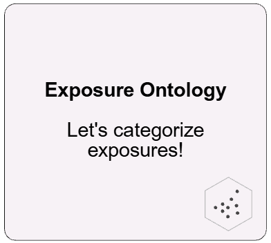
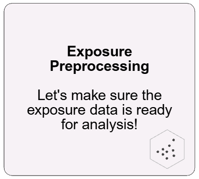
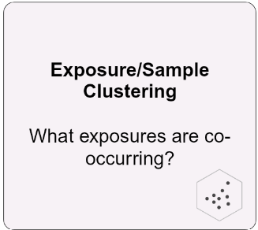
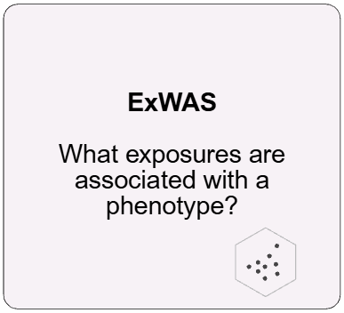
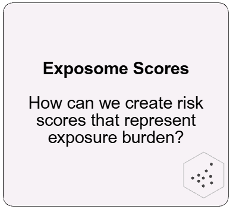
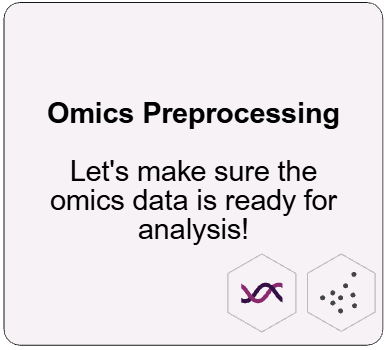
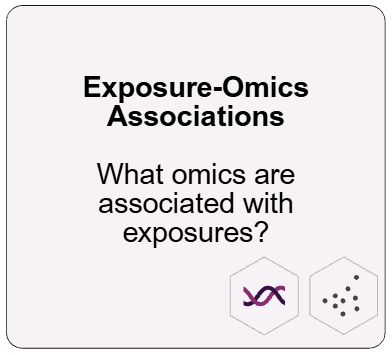
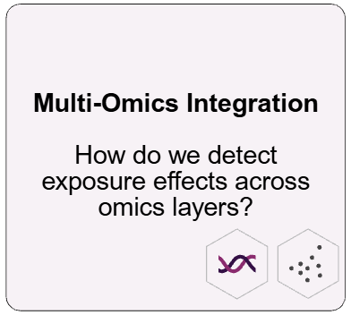
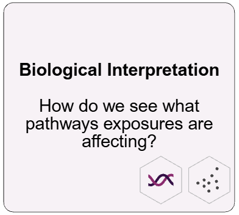
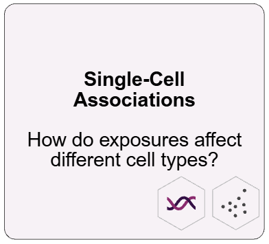

# Getting Started with tidyexposomics

Tidyexposomics let’s you connect exposures, to phenotypes to omics,
which is a lot of ground to cover! We provide a series of tutorials that
take you through how to do this. We support exposure-phenotype only
workflows and those with omics data included too.

Got an idea for a tutorial you want? Feel free to submit a request
[here](https://github.com/BioNomad/tidyexposomics/issues/new)!

### Exposure-Phenotype Analysis

*Data to have: exposures and phenotypes*

### Exposure-Phenotype-Omics Analysis

*Data to have: exposures, omics, and phenotypes*

