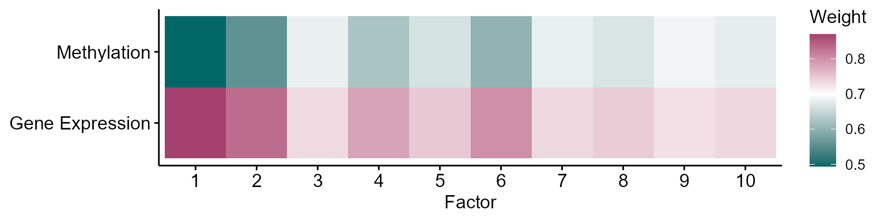
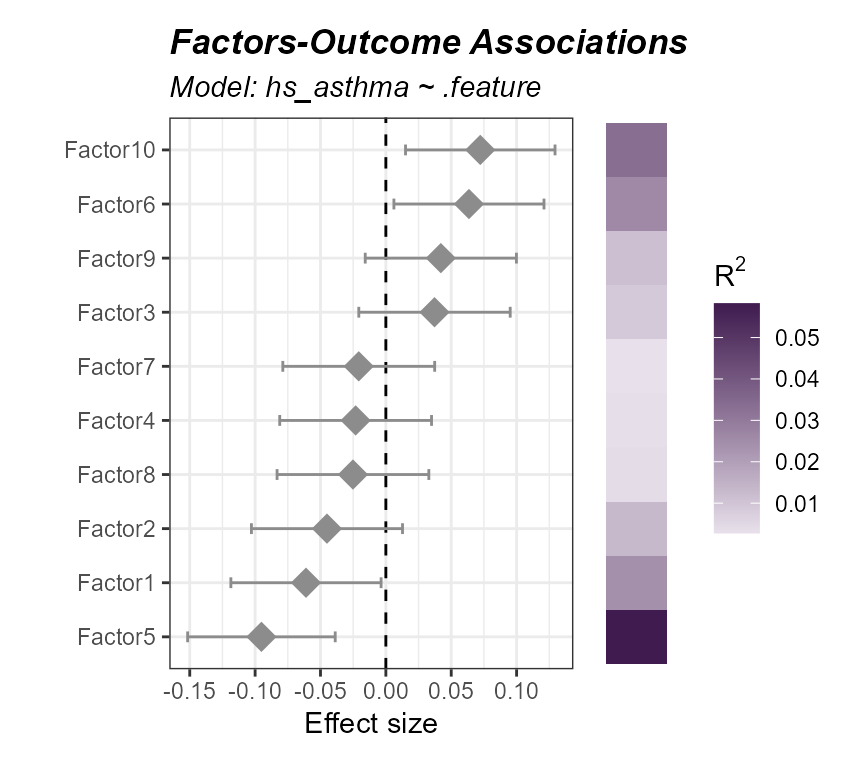
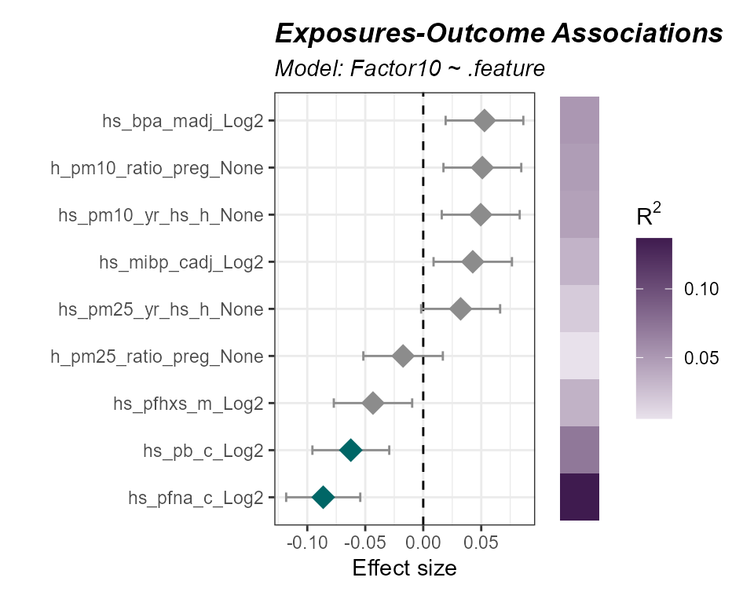
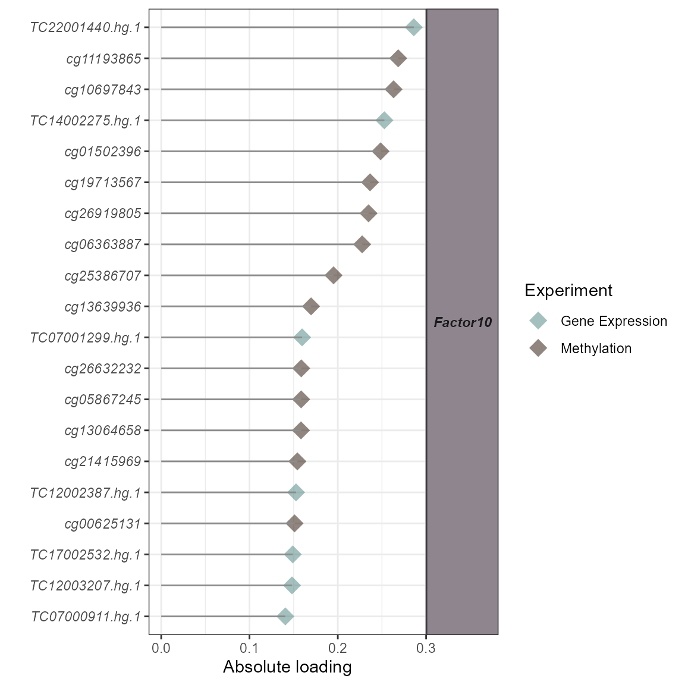

# Multi-omics Integration

[Previous: Exposure-Omics
Associations](https://BioNomad.github.io/tidyexposomics/articles/exposure_omics_associations.md)

**Objectives**

- Derive latent factors that summarize shared variation across omics
  layers.
- Assess each omic layer’s contribution to those factors.
- Associate latent factors with an outcome and identify the features
  driving them.
- Understand when factor-based integration is (and isn’t) the right
  tool.

## Prerequisites

We covered [omics/exposure
preprocessing](https://BioNomad.github.io/tidyexposomics/articles/omics_preprocessing.md)
in a previous vignette. Here is the quick start code to catch you up to
speed!

Click to expand code

``` r
# Load Libraries
library(tidyverse)
library(tidyexposomics)

# Load example data
data("tidyexposomics_example")

# Create exposomic set object
expom <- create_exposomicset(
    codebook = tidyexposomics_example$annotated_cb,
    exposure = tidyexposomics_example$meta,
    omics = list(
        "Gene Expression" = tidyexposomics_example$exp_filt,
        "Methylation" = tidyexposomics_example$methyl_filt
    ),
    row_data = list(
        "Gene Expression" = tidyexposomics_example$exp_fdata,
        "Methylation" = tidyexposomics_example$methyl_fdata
    )
)

# Grab exposure variables
exp_vars <- tidyexposomics_example$annotated_cb |>
    filter(category %in% c(
        "aerosol",
        "main group molecular entity",
        "polyatomic entity"
    )) |>
    pull(variable) |>
    as.character()

# Impute missing values
expom <- run_impute_missing(
    exposomicset = expom,
    exposure_impute_method = "missforest",
    exposure_cols = exp_vars
)

# Check variable normality
expom <- run_normality_check(
    exposomicset = expom,
    action = "add"
)

# Transform variables
expom <- transform_exposure(
    exposomicset = expom,
    transform_method = "boxcox_best",
    exposure_cols = exp_vars
)
```

## Multi-omics Integration

Biology is not as simple as one molecular readout. We are composed of
many different types of biomolecules (e.g. DNA, RNA, proteins,
metabolites, etc..) which interact with one another in intricate ways.
This means that there is shared variation between omics layers that may
be useful to capture. These axes of shared variation can be expressed as
latent factors which you can think of as summaries of joint multi-omics
relationships. `tidyexposomics` provides several ways to get latent
factors, here we will use `nipalsMCIA` to calculate 10 latent factors:

``` r
# setting a random seed, since factor determination can fail
# to converge for smaller toy datasets
set.seed(42)

# run multi-omics integration
expom <- expom |> 
  run_multiomics_integration(
    method = "MCIA",
    n_factors = 10,
    scale = TRUE
  )
```

Now each omic layer may contribute more or less to the variation in that
factor, let’s visualize these contributions:

``` r
# plot factor summary
expom |>
  plot_factor_summary(midpoint = 0.7)
```

 Here we
see that most factors are influenced by the gene expression layer, given
they tend to have higher weights.

## Factor-outcome Associations

Each factor is a sample-level summary of our omics layers, meaning we
can associate these factors with an outcome. Here we see wh

``` r
# run association between factors and asthma status
expom |> 
  run_association(
    formula = hs_asthma ~ .feature,
    source = "factors",
    feature_set = paste0("Factor",1:10)) |> 
  plot_association(
    source = "factors",
    r2_col = "r2",
    filter_col = "p.value",
    filter_thresh = 0.05)
```



While none of these associations are significant (quirk of this smaller
toy datasets) we do see that factor 10 is associated with an increased
odds of asthma. Let’s see which exposures tend to be associated with
factor 10:

``` r
# run factor-exposure association analysis
expom |> 
  run_association(
    formula = Factor10 ~ .feature,
    feature_set = exp_vars,
    source = "exposures") |> 
  plot_association(
    source = "exposures",
    r2_col = "r2",
    filter_col = "p.value",
    filter_thresh = 0.1)
```



Here we note that lead and PFNA exposure are associated with a decrease
in Factor 10.

## Omics Feature contributions

While we do lose the granular omic-feature-level information when we
create these low dimensional factors, we can see which omics features
are associated with these factors. This is known as an omics loading
value on that factor. Let’s see which omics features contribute most to
factor 10:

``` r
expom |> 
  plot_top_factor_features(
    factors = "Factor10",
    top_n = 20)
```



## Quirks of Multi-omics

So you may be wondering, why not determine latent factors to get the
shared biology all the time? In other words, why would you bother doing
differential expression/abundance per omic layer? Well for one, the
per-layer approach allows you more granular insight into what is
changing. Factor analysis will tell you which axes of biology are
important, but not necessarily this level of detail. Also watch out for
differences the number of features per omic layer. If your gene
expresssion matrix has ~20,000 features and your proteomics layer has
~500, then the one with more features will tend to dominate your
factors. Still, multi-omics integration techniques can be useful in
identifying shared axes of variation, they just need a little more care
when interpreting the biology.

[Next: Biological
Interpretation](https://BioNomad.github.io/tidyexposomics/articles/biological_interpretation.md)
