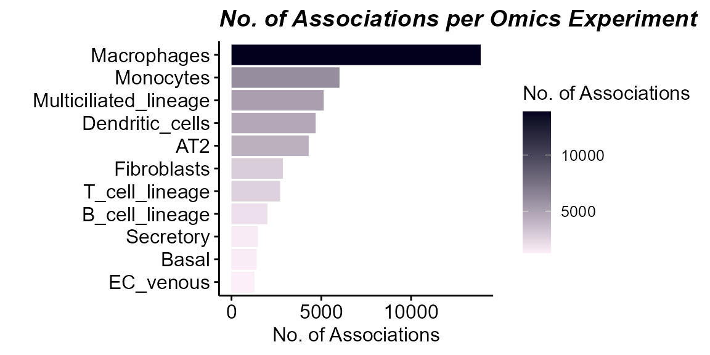

# Single-cell-Exposure Associations

[Previous: Biological
Interpretation](https://BioNomad.github.io/tidyexposomics/articles/biological_interpretation.md)

**Objectives**

- Convert single-cell data (`SingleCellExperiment` or `Seurat`) into an
  `exposomicset` by pseudobulking per cell type.
- Filter lowly expressed genes within each cell type.
- Identify exposure-responsive cell types by testing exposure-omics
  associations.
- Determine which exposures drive the most associations across cell
  types.
- Run GO enrichment on exposure-associated genes to interpret effects
  per cell type.

## Prerequisites

To integrate single-cell data into `tidyexposomics` you need to perform
cell type annotation. For now, we recommend following the [Seurat PBMC
3K tutorial](https://satijalab.org/seurat/articles/pbmc3k_tutorial).
Then once you have cell type annotations, feel free to move onto the
next section!

## Single-cell Integration

To integrate single-cell workflows with `tidyexposomics` we provide a
wrapper function `transform_sce_to_exposomicset`. This function will
take a `SingleCellExperiment` or `Seurat` object, pseudobulk to get gene
by sample matrices per cell type and convert the whole thing to a
`MultiAssayExperiment` object:

``` r
# load libraries
library(tidyexposomics)
library(tidyverse)

# make an small example SingleCellExperiment object
sce <- make_example_sc()

# make the codebook for the example SingleCellExperiment object
codebook <- make_example_sce_codebook()

# transform this object into an exposomicset
mae_small <- transform_sce_to_exposomicset(
     sce              = sce,
     codebook         = codebook,
     sample_col       = "sample",
     cluster_col      = "celltype",
     sample_meta_cols = codebook$variable
 )
```

Now, this small toy dataset lacks a lot of the complexity of real data.
So we have taken the Human Cell Lung Atlas, simulated exposure data, and
converted it to a MultiAssayExperiment object in the same we did before
with the toy data. This gives a more real world example of what you
would be likely to encounter.

``` r
# download our HCA Lung Atlas data
hca_lung <- download_dataset("hca_lung")

# define our exposure variables
exposures <- hca_lung |> 
  extract_results(result = "codebook") |>
  filter(!category %in% c("covariate","metadata","outcome","id")) |> 
  pull(variable)

# take a look at our object
hca_lung
```

    ## A MultiAssayExperiment object of 11 listed
    ##  experiments with user-defined names and respective classes.
    ##  Containing an ExperimentList class object of length 11:
    ##  [1] Macrophages: SummarizedExperiment with 27402 rows and 115 columns
    ##  [2] AT2: SummarizedExperiment with 27402 rows and 86 columns
    ##  [3] Basal: SummarizedExperiment with 27402 rows and 97 columns
    ##  [4] EC_venous: SummarizedExperiment with 27402 rows and 106 columns
    ##  [5] T_cell_lineage: SummarizedExperiment with 27402 rows and 114 columns
    ##  [6] Fibroblasts: SummarizedExperiment with 27402 rows and 101 columns
    ##  [7] Multiciliated_lineage: SummarizedExperiment with 27402 rows and 138 columns
    ##  [8] B_cell_lineage: SummarizedExperiment with 27402 rows and 88 columns
    ##  [9] Secretory: SummarizedExperiment with 27402 rows and 137 columns
    ##  [10] Monocytes: SummarizedExperiment with 27402 rows and 103 columns
    ##  [11] Dendritic_cells: SummarizedExperiment with 27402 rows and 127 columns
    ## Functionality:
    ##  experiments() - obtain the ExperimentList instance
    ##  colData() - the primary/phenotype DataFrame
    ##  sampleMap() - the sample coordination DataFrame
    ##  `$`, `[`, `[[` - extract colData columns, subset, or experiment
    ##  *Format() - convert into a long or wide DataFrame
    ##  assays() - convert ExperimentList to a SimpleList of matrices
    ##  exportClass() - save data to flat files

Here we see that each cell type is its own experiment in the
MultiAssayExperiment object. Now let’s demonstrate how we would identify
cell types that are exposure-responsive.

## Preprocessing

### Exposure Preprocessing

The exposure data here was simulated and doesn’t need preprocessing. For
your own workflows, please follow the [exposure preprocessing
tutorial](https://BioNomad.github.io/tidyexposomics/articles/exposure_preprocessing.md).

### Filtering Omics Layers

Single cell types do not typically express all ~20,000 genes, and
including all of them will dilute our signal. So let’s filter each of
these matrices to retain genes that are highly expressed:

``` r
# filter each assay to retain features with at 
# least a CPM of 1 in 30% of samples
hca_lung <- hca_lung |> 
  filter_omics(
  method = "expression",
  assays = experiments(hca_lung) |> names(),
  assay_name = 1,
  min_value = 1,
  min_prop = 0.3
)
```

## Exposure-responsive Cells

The easiest way to identify exposure-responsive cells is to see how many
exposures each cell’s omics features are associated with. Let’s try this
out!

``` r
# run exposure-cell type omics associations
hca_lung <- hca_lung |> 
  run_exposure_omics_association(
    formula = ~ .feature,
    exposures = exposures)
```

Now to see which cell type had the greatest number of associations with
exposures:

``` r
# plot the exposure-responsive cell types
plot_exposure_omics_association(
    exposomicset = hca_lung,
    plot_type = "exp_name",
    pval_col = "p.value",
    pval_thresh = 0.05)
```



Here we can see that macrophages and monocytes have the greatest number
of associations. Now let’s see which exposures are driving this:

``` r
# plot the top exposures
plot_exposure_omics_association(
    exposomicset = hca_lung,
    plot_type = "exposures",
    pval_col = "p.value",
    pval_thresh = 0.05)
```


Here we see that Radon and Ozone have the greatest number of omics
associations.

## Biological Interpretation

Now let’s say we were interested in the biological effects of radon per
cell type. Let’s run gene ontology (GO) enrichment analysis to figure
this out! Keep in mind for our variable map, we need the two columns to
be `exp_name` and `variable`. `variable` must be `feature` for omics
features.

``` r
# create the variable map for the cell types and significant
# radon-associated features
var_map <- hca_lung |> 
  extract_results("association") |>
  pluck("exposure_omics","results_df") |>
  filter(p.value<0.05,
         exposure=="radon") |> 
  distinct(exp_name=exp_name,
           variable = feature)
```

Now to run our enrichment analysis:

``` r
# run enrichment analysis on radon-associated features
hca_lung <- run_enrichment(
    exposomicset = hca_lung,
    variable_map = var_map,
    feature_type = "omics",
    feature_col = "feature_name",
    db = c("GO"),
    species = "goa_human",
    fenr_col = "gene_symbol",
    padj_method = "none",
    pval_thresh = 0.05,
    min_set = 1,
    max_set = 800,
    clustering_approach = "diana",
    action = "add"
)
```

And let’s visualize these results with a dotplot to see per-cell type
results:

``` r
# Plot a dotplot of terms
plot_enrichment(
    exposomicset = hca_lung,
    feature_type = "omics",
    plot_type = "dotplot",
    top_n = 3,
    add_top_genes = TRUE,
    top_n_genes = 5
)
```

    ## NULL

Here we see that radon is associated with changes in stress response
pathways, RNA binding, and kinase activity, particularly in Macrophages.
