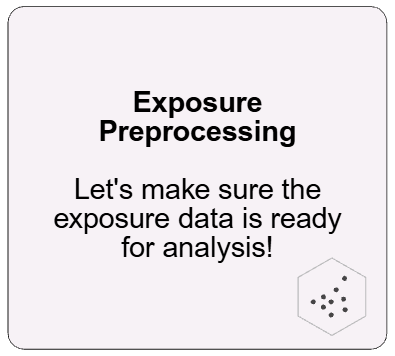
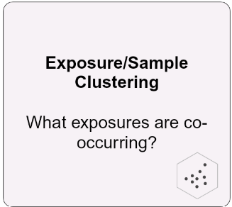
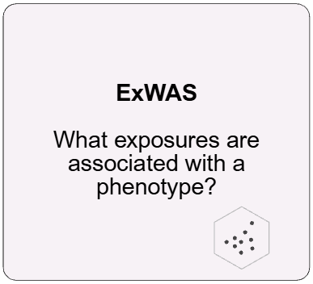
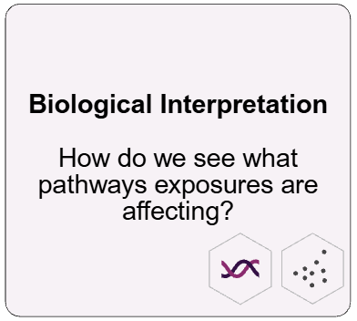

# Getting Started with tidyexposomics

Tidyexposomics let’s you connect exposures, to phenotypes to omics,
which is a lot of ground to cover! We provide a series of tutorials that
take you through how to do this. We support exposure-phenotype only
workflows and those with omics data included too.

Got an idea for a tutorial you want? Feel free to submit a request
[here](https://github.com/BioNomad/tidyexposomics/issues/new)!

### Exposure-Phenotype Analysis

*Data to have: exposures and phenotypes*

[](https://BioNomad.github.io/tidyexposomics/articles/exposure_annotation.md)
[](https://BioNomad.github.io/tidyexposomics/articles/exposure_preprocessing.md)
[](https://BioNomad.github.io/tidyexposomics/articles/exposure_sample_clustering.md)
[](https://BioNomad.github.io/tidyexposomics/articles/exwas.md)
[](https://BioNomad.github.io/tidyexposomics/articles/exposome_scores.md)

### Exposure-Phenotype-Omics Analysis

*Data to have: exposures, omics, and phenotypes*

[](https://BioNomad.github.io/tidyexposomics/articles/omics_preprocessing.md)
[](https://BioNomad.github.io/tidyexposomics/articles/exposure_omics_associations.md)
[](https://BioNomad.github.io/tidyexposomics/articles/multi_omics_integration.md)
[](https://BioNomad.github.io/tidyexposomics/articles/biological_interpretation.md)
[](https://BioNomad.github.io/tidyexposomics/articles/single_cell_exposure_associations.md)

Session Info

``` r
sessionInfo()
```

    ## R version 4.5.1 (2025-06-13 ucrt)
    ## Platform: x86_64-w64-mingw32/x64
    ## Running under: Windows 11 x64 (build 26200)
    ## 
    ## Matrix products: default
    ##   LAPACK version 3.12.1
    ## 
    ## locale:
    ## [1] LC_COLLATE=English_United States.utf8 
    ## [2] LC_CTYPE=English_United States.utf8   
    ## [3] LC_MONETARY=English_United States.utf8
    ## [4] LC_NUMERIC=C                          
    ## [5] LC_TIME=English_United States.utf8    
    ## 
    ## time zone: America/New_York
    ## tzcode source: internal
    ## 
    ## attached base packages:
    ## [1] stats     graphics  grDevices utils     datasets  methods   base     
    ## 
    ## other attached packages:
    ## [1] BiocStyle_2.38.0
    ## 
    ## loaded via a namespace (and not attached):
    ##  [1] cli_3.6.5           knitr_1.51          rlang_1.3.0        
    ##  [4] xfun_0.60           otel_0.2.0          textshaping_1.0.5  
    ##  [7] jsonlite_2.0.0      htmltools_0.5.9     ragg_1.5.2         
    ## [10] sass_0.4.10         rmarkdown_2.31      evaluate_1.0.5     
    ## [13] jquerylib_0.1.4     fastmap_1.2.0       yaml_2.3.12        
    ## [16] lifecycle_1.0.5     bookdown_0.47       BiocManager_1.30.27
    ## [19] compiler_4.5.1      fs_2.1.0            htmlwidgets_1.6.4  
    ## [22] rstudioapi_0.19.0   systemfonts_1.3.2   digest_0.6.39      
    ## [25] R6_2.6.1            bslib_0.12.0        tools_4.5.1        
    ## [28] pkgdown_2.2.1       cachem_1.1.0        desc_1.4.3
