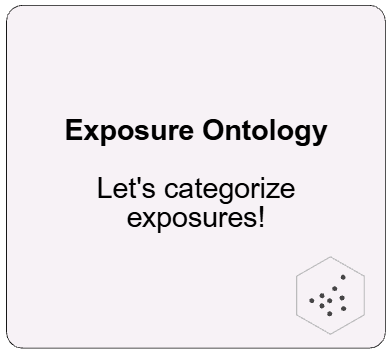
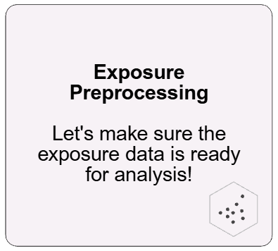
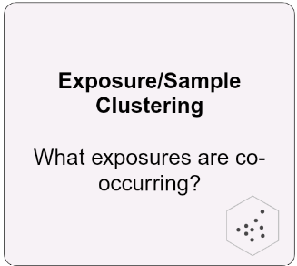
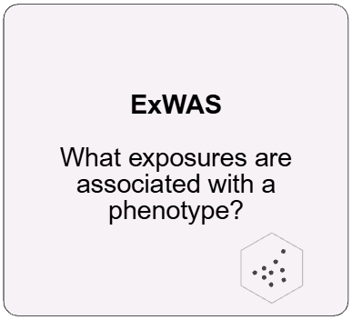
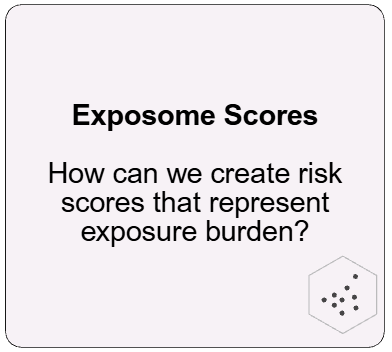
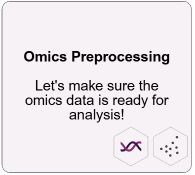
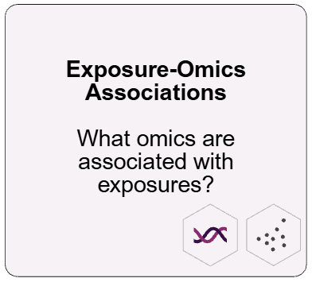
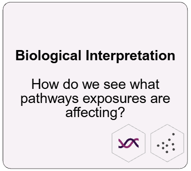
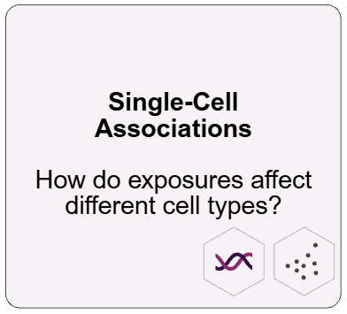

```{r setup,include=FALSE}
knitr::opts_chunk$set(echo = TRUE)
```

Tidyexposomics let's you connect exposures, to phenotypes to omics, which is a lot of ground to cover! We provide a series of tutorials that take you through how to do this. We support exposure-phenotype only workflows and those with omics data included too. 

Got an idea for a tutorial you want? Feel free to submit a request [here](https://github.com/BioNomad/tidyexposomics/issues/new)!

### Exposure-Phenotype Analysis

*Data to have: exposures and phenotypes* 

<div style="display: inline-block;">
<a href="exposure_annotation.html">
  
</a> 
<a href="exposure_preprocessing.html">
  
</a> 
<a href="exposure_sample_clustering.html">
  
</a> 
<a href="exwas.html">
  
</a> 
<a href="exposome_scores.html">
  
</a> 
</div>


### Exposure-Phenotype-Omics Analysis

*Data to have: exposures, omics, and phenotypes* 

<div style="display: inline-block;"><a href="omics_preprocessing.html">
  
</a> 
<a href="exposure_omics_associations.html">
  
</a> 
<a href="multi_omics_integration.html">
  
</a> 
<a href="biological_interpretation.html">
  
</a> 
<a href="single_cell_exposure_associations.html">
  
</a> 
</div>


<details>
<summary>Session Info</summary>

```{r si}
sessionInfo()
```

</details>
